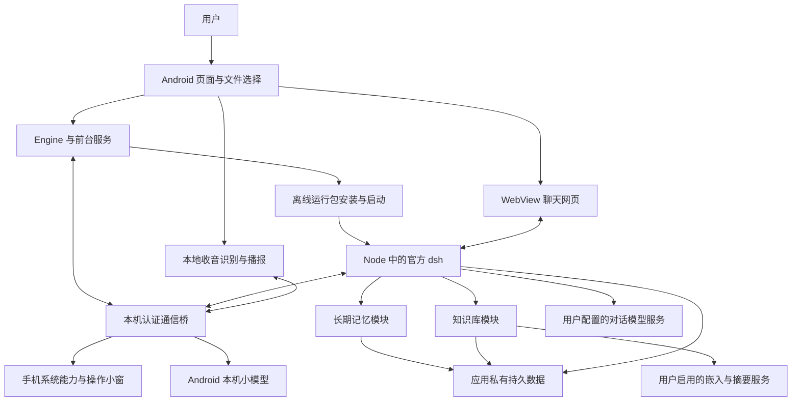

# DSHX

DSHX 是将 DeepSeek 官方 **deepseek-harness（下文称 dsh）**移植到 Android 的手机 AI 助手项目。dsh 是随应用打包的智能体引擎，由应用启动，负责模型请求、多轮对话、会话日志、工具调度和插件；DSHX 在其外层提供 Android 页面、进程管理、手机能力、本地语音、长期记忆和知识库。

正式应用位于 `app/`，Android 适配代码与运行环境配方位于 `core/`、`tools/`。当前为开发版本，尚未完成正式发布验收。

产品目标是支持自定义名字、身份与提示词，通过文字和语音使用同一套会话与工具，自带智能知识库，并用本机短对话分流、有限记忆召回和按需资料读取控制模型输入量。
模型服务：普通对话仍请求用户在 dsh 中配置的模型服务；语音识别、本机小模型和离线播报使用各自准备的本地模型；知识嵌入与集合摘要在启用后请求所选服务。

## 阅读入口

- [术语与整体架构](#术语与整体架构)：先理解谁负责页面、谁负责执行、谁保存数据。
- [目录与模块总览](#目录与模块总览)：按目录定位源码、构建工具和历史原型。
- [模块职责与工作原理](#模块职责与工作原理)：逐项说明入口、数据、算法和边界。
- [典型执行流程](#典型执行流程)：串起文字聊天、手机操作、语音和知识导入。
- [数据目录与备份范围](#数据目录与备份范围)：说明文件位置、迁移和恢复规则。
- [构建与定向验证](#构建与定向验证)：准备依赖、选择架构和验证范围。
- [文档索引与验收状态](#文档索引与验收状态)：查找专题说明、验证证据和待完成事项。

## 术语与整体架构

下列概念贯穿后文；表中的“创建方”说明对象由谁创建，或相关配置由谁提供。

| 名称 | 它是什么、创建方与职责 | 与相近概念的区别 |
|---|---|---|
| Android 宿主 | `app/` 中的 Kotlin 应用，由 Android 系统创建；提供页面、前台服务、文件选择、权限入口和本机进程管理 | 宿主启动 dsh，但本身不重新实现完整聊天引擎 |
| Node.js（Node） | 随运行包分发、由宿主启动的 JavaScript 执行程序；运行 dsh 与 `core/*.mjs` | Node 是运行程序的环境，dsh 是在其中执行的业务引擎 |
| 运行包（core） | `tools/core.py` 构建、随 APK 分发的离线文件集合，包含 Node、dsh、网页、命令和适配模块；APK 是 Android 安装包 | 运行包可以替换；用户会话、资料、凭据不应存放在其中 |
| 智能体（Agent） | dsh 在处理会话时创建的执行对象，负责逐步请求模型并执行工具 | 它有当前执行状态；会话保存可在重启后恢复的历史，两者不等同 |
| 会话（Session） | dsh 创建并分配唯一编号的一段对话，保存消息、请求配置和工具事件 | 会话标题可改，编号不变；会话历史也不等于独立长期记忆 |
| 工具（Tool） | 引擎向模型声明的命名操作，模型提交名称和结构化参数后，由已注册实现执行 | 模型提出调用不代表已执行成功；网页上用户直接操作的终端、插件管理也有各自入口 |
| 原生通信桥 | 每次启动由 `Engine` 创建的 `PolicyBridge` 服务端，以及 Node 中的 `host.mjs` 客户端；用本机认证连接交换会话、手机、本地模型和管理请求 | 它是按行传 JSON 的 TCP 长连接，TCP 是进程间传输字节的连接协议；与浏览器加载聊天网页的 HTTP 服务分开 |
| 启动实例（instance） | `Engine` 每次启动时生成的随机编号，绑定本次通信、会话登记和取消状态 | 重新启动会变更实例编号，持久保存的会话编号仍可保持不变 |
| Full（完全权限） | 宿主为本次有效登记的会话统一返回的工具准入模式，允许使用应用已有系统访问权限 | 不授予手机 root，也不替代系统权限或手机能力开关；工作区只是默认目录 |
| 工作区（workspace） | 应用创建的默认任务目录，也用于区分当前项目的记忆和资料可见范围 | Full 下工作区不是文件隔离边界；知识工具仍按真实会话范围过滤来源 |
| 长期记忆 | 由用户管理、或由受控后台整理任务生成的偏好、事实和经验；存储模块保存独立条目 | 不把全部会话原文当作记忆，也不包含用户导入的全部参考文档 |
| 知识库 | 用户主动导入的 Markdown、TXT 等参考资料，以及用于检索的分块、索引和概览 | 文档正文与记忆条目分开存储；统一搜索只组合可见结果，不合并两种正式数据 |
| 数据领域（storage domain） | dsh 的 `dsh-storage-domain` 提供的持久化接口；记忆和知识模块分别声明自己的数据结构，再由 JSON 后端写盘 | 它约束业务状态与写入方式；不表示另外运行一个数据库服务器 |
| 修订号（revision） | 存储模块在内容或设置变更时递增的数字，管理端带上读到的旧值保存，用于发现并发编辑 | 正文版本表示某份文档的内容版本；任务状态代次 `epoch` 用于使旧整理任务失效，三者用途不同 |
| 嵌入（embedding）与向量 | 用户指定的嵌入模型把文字转成一组数字，知识模块用这些数字比较语义相似程度 | 嵌入模型不生成聊天回答；对话服务可用不代表同一服务支持嵌入接口 |
| token 与上下文 | token 是模型计量文本的单位，上下文是单次模型能接收的输入与输出容量；容量来自实际模型信息 | token 不等于字符或 UTF-8 字节；部分模块用字节作保守上界，账本只记录实际报告的用量 |

整体关系如下。两个方向的箭头表示请求与结果交接，不表示数据自动同步到外部服务。



图中的 **WebView** 是 Android 系统提供、由 `MainActivity` 创建的网页容器，用于显示随 dsh 打包的聊天页面；它的网页渲染进程与 Node 引擎进程分别运行。**前台服务**是 Android 为持续任务提供、带常驻通知的服务组件，由用户操作触发系统创建，用于管理引擎或麦克风生命周期，不等于应用页面一直可见。

## 目录与模块总览

| 目录或入口 | 作用 | 是否进入正式应用 |
|---|---|---|
| [`app/`](app/) | Kotlin Android 宿主，包含管理页面、服务、手机桥、语音、文件交接与会话备份 | 是，正式模块 |
| [`app/src/main/cpp/`](app/src/main/cpp/) | 本机小模型的 C++ 调用层及 CMake 编译配置 | 是，编译成原生库 |
| [`app/src/main/assets/`](app/src/main/assets/) | 网页主题、模型清单、语音小文件与许可，以及构建生成的三个运行包资源 | 是；大型按需模型另行下载 |
| [`core/`](core/) | Node 侧 Android 适配、手机工具、语音接入、记忆、知识、依赖锁定与原生兼容代码 | 指定运行文件由构建工具收集，非整个目录原样打包 |
| [`tools/core.py`](tools/core.py) | 准备官方 dsh 与 Android 命令，应用固定补丁、编译兼容层并生成运行包 | 开发机工具，手机不执行该 Python 脚本 |
| [`tools/voice.py`](tools/voice.py) | 准备固定语音运行库、唤醒资源、模型清单和 llama.cpp 源码 | 开发机工具 |
| [`app/src/test/`](app/src/test/) · [`core/test.mjs`](core/test.mjs) | 当前宿主与适配模块的定向回归测试 | 不作为正式功能打包 |
| [`prototype/`](prototype/) | 早期独立原型，演练文件整理、任务确认、停止和恢复交互 | 独立安装，不是正式聊天引擎 |
| [`p0/`](p0/) · [`tools/p0.py`](tools/p0.py) | 早期任务样本、调研模板、环境采集及证据记录 | 不进入正式运行链路 |
| [`settings.gradle.kts`](settings.gradle.kts) · [`build.gradle.kts`](build.gradle.kts) · [`gradle/`](gradle/) | 注册 `app` 和 `prototype` 两个模块，固定构建插件与 Gradle Wrapper | 开发机构建基础 |
| `build/outputs/` · `core/cache/` · `core/node_modules/` | 本机产物、证据、下载缓存和依赖安装目录 | 不作为源码提交；其中选定内容会被构建工具装入运行包 |

## 模块职责与工作原理

### 1. 应用生命周期与引擎管理

**入口与持有关系。** Android 根据应用清单创建 `DshApp`，它按需创建一份 `Engine` 和一份 `VoiceControl`。后者是语音状态协调对象，后文单独说明。页面重建只重新订阅状态，不重新创建第二个引擎。

| 文件或组件 | 作用及协作方式 |
|---|---|
| [`AndroidManifest.xml`](app/src/main/AndroidManifest.xml) | 向 Android 声明应用、页面、前台服务、无障碍服务、文件分享入口与所需权限；声明权限不等于用户已经授权 |
| [`EngineService.kt`](app/src/main/java/local/dshx/app/EngineService.kt) 中的 `DshApp` | 持有应用进程共享的引擎和语音状态，避免把生命周期绑定到某一张页面 |
| 同文件中的 `EngineService` | 接收启动、停止操作，建立常驻状态通知并观察引擎状态；系统结束服务后不自动继续旧模型任务 |
| [`Engine.kt`](app/src/main/java/local/dshx/app/Engine.kt) | 在后台串行执行安装、启动、读取输出和停止收尾；向页面发布阶段、地址、备份和文件传输状态 |
| [`EngineRecovery.kt`](app/src/main/java/local/dshx/app/EngineRecovery.kt) | 保存实际异常标记 `.trust-pending`，并在启停时核实、结束属于本应用的残留子进程；不负责绘制页面或保存会话 |
| [`launcher.c`](core/launcher.c) | 编译成 `dshx-run` 启动器，在执行 Node 前绑定宿主死亡信号；宿主进程消失时结束直接 Node 进程 |

**启动原理。** 用户启动前台服务后，`Engine` 先处理残留进程，再读取包内运行清单并检查设备架构。普通重开复用已安装运行环境；首次安装、版本变化或故障恢复时进入完整校验。随后准备用户目录，迁移旧数据路径，读取助手设置，写入本次 Android 适配配置，生成新的启动实例和认证信息，再通过 `dshx-run` 执行 Node。

Node 使用 `--import compat.mjs` 先加载兼容层，再执行 [`start.mjs`](core/start.mjs)。这个入口从运行包加载官方 `runCli()`，传入 Android 内置包管理程序配置，按宿主参数进入 dsh 网页模式。网页服务只监听 `127.0.0.1`，即本机回环地址，使用随机端口和启动认证。宿主仅接受符合固定格式的就绪地址交给 WebView；诊断显示脱敏后的日志，不直接展示认证地址。

**停止与失败。** 用户停止会撤销通信、请求结束进程，超过等待时间后强制结束并核实残留。完整收尾结束后才允许下一次启动。正常停止保留配置、会话和工作文件；实际故障才标记下一次检查。`EngineRecovery` 不在每次正常命令后重建用户配置。`dshx-run` 的父进程绑定直接保护 Node，所有后代进程的收尾还需引擎的进程核实，不能仅凭启动器推断全部子进程已结束。

### 2. 离线运行包安装与完整性检查

**作用。** [`CoreStore.kt`](app/src/main/java/local/dshx/app/CoreStore.kt) 由 `Engine` 创建，负责把 APK 内的运行资源安装到应用私有目录。这里“离线”指安装运行环境无需临时下载 Node 或 dsh；不表示云端模型调用无需联网。

运行包分为三个文件：

| 资源 | 谁生成、保存什么、谁使用 |
|---|---|
| `core.zip` | `tools/core.py` 生成的运行文件压缩包，由 `CoreStore` 解包 |
| `core.json` | 同一构建生成的机器校验清单，包含架构、版本、压缩包大小与 SHA-256、逐文件大小与执行位；SHA-256 是用于核对内容是否相同的摘要值 |
| `core-info.json` | 同一构建生成的摘要信息，供管理页显示并辅助 Gradle 选择架构；不代替完整安装校验 |

**安装原理。** 安装器先检查空间，把压缩包复制到暂存位置并核对整体摘要，再逐文件解压、核对内容摘要、大小和路径。全部成功后写 `.verified` 安装收据，并将暂存目录改名为正式版本目录。重复路径、越界路径、未登记文件、缺失文件和取消都会阻止激活。

**快速启动与修复的区别。** `installed()` 只检查收据和固定启动文件的存在、大小、执行位；`current()` 遍历整个版本目录，检查所有文件摘要及额外内容；`install()` 先尝试完整复用，不合格时重新安装。普通启动不重复扫描全部依赖，以减少冷启动开销。因此快速检查不保证识别任意同大小内容变更，也不构成同一应用身份内恶意代码之间的隔离。

运行目录使用 `<版本>-<压缩包摘要前16位>`，同一上游版本的不同构建互不覆盖。旧版本不会自动回收，也没有通用一键回退入口；运行包升级不应覆盖用户目录。

### 3. 原生管理界面与官方聊天网页

| 文件或资源 | 谁创建或加载、负责什么 |
|---|---|
| [`MainActivity.kt`](app/src/main/java/local/dshx/app/MainActivity.kt) | Android 创建的主页面入口；订阅引擎与语音状态，创建 WebView，处理麦克风等权限、附件选择、手机目录授权、备份及知识文件选择 |
| [`DshScreen.kt`](app/src/main/java/local/dshx/app/DshScreen.kt) | 由主页面调用的 Kotlin Compose 界面；Compose 是按状态声明界面的 Android UI 框架，本文件组织工作台、聊天容器、助手设置、手机设置、语音、记忆和知识管理 |
| [`chat.css`](app/src/main/assets/chat.css) | 主页面在可信聊天页加载后注入的网页样式，统一网页语义色、边框、圆角和焦点外观；不负责工具准入或模型路由 |
| `res/` 中的图标、字符串和 XML | 由 Android 构建打包；提供应用标识、无障碍描述和文件分享路径等系统资源 |

管理页面使用 **Miuix 0.8.8**（Kotlin 控件库）和 Lucide 图标，由 Gradle 声明依赖；视觉沿用 Qoder 的暖中性色与克制边框。聊天网页仍使用固定版本 dsh 自带的 React 页面，React 是上游组织网页组件的框架；项目没有另写一套独立聊天状态。

工作台显示实际启停状态和按需诊断；聊天页承载官方聊天、模型配置、会话及网页入口；设置页管理手机宿主增加的功能。网页组件要求 Chromium 126 或更新版本。服务是否运行、网页是否加载成功、模型是否请求成功分别判断，不能互相代替。

附件选择绑定当前 WebView 和启动实例：系统文件选择器返回后，只把可读且仍属于当前页面的文件引用交还聊天页；旧实例、取消或不可读文件不生成附件。网页选择会话还会通知原生语音模块，使语音接入当前会话。网页只提供必要的宿主交接，不因此获得任意原生方法调用能力。

### 4. 本机通信、会话登记与工具准入

| 文件或组件 | 作用 |
|---|---|
| [`ToolPolicy.kt`](app/src/main/java/local/dshx/app/ToolPolicy.kt) | `Engine` 创建的本次运行会话登记表，保存编号、父子关系、根会话及统一 Full 状态；不持久保存聊天内容 |
| [`PolicyBridge.kt`](app/src/main/java/local/dshx/app/PolicyBridge.kt) | `Engine` 每次启动创建的本机 TCP 服务端，校验实例和随机认证值，处理会话登记、查询、手机调用、本机推理和原生管理请求 |
| [`host.mjs`](core/host.mjs) 中的 `PolicyHost` | Node 侧连接客户端，维护会话状态缓存、请求编号、超时和取消；同时接收 Android 发来的语音、记忆、知识管理请求 |
| [`guard.mjs`](core/guard.mjs) | 作为固定 Android 插件加载，监听 dsh 智能体创建、请求、空闲和销毁，登记会话、收尾手机动作，并安装工具准入检查及运行事实提示 |
| [`policy.mjs`](core/policy.mjs) | 定义工具可见性、最终调用检查、文件路径处理和单次异步调用上下文；不是系统权限申请器 |

**连接如何工作。** 宿主启动本机随机端口，将端口、实例和认证值仅传给本次 Node 子进程。客户端首先发送 `version`、`instance`、`token` 握手；服务端成功后只接纳一条有效主连接。后续 JSON 消息以换行分隔，并检查字段、长度、请求编号和状态修订号。

这是一条双向连接：Node 向 Android 查询会话并请求手机或本机推理；Android 向 Node 请求语音对话、记忆管理和知识管理。手机操作及本机生成放到独立线程，避免长操作堵住状态查询和取消。连接失效时双方清空有效状态、拒绝后续调用，宿主请求停止引擎；不会凭旧缓存恢复权限。

**会话如何准入。** `guard.mjs` 从 dsh 自己的智能体关系取得父子归属，先登记父会话再登记子会话。宿主最多保存 64 个活跃会话、256 个本次运行归属记录。合法登记统一 Full；结束父会话时撤销其活跃后代，重启清空运行登记。磁盘上的聊天历史继续保留。

**工具如何限制。** 工具目录只向模型展示当前适配且可用的操作；真正执行入口再次检查名称、参数和实时会话。`policy.mjs` 使用 Node 的 `AsyncLocalStorage`，即为各条异步调用分别保存上下文的机制，防止并发工具把“当前会话”“文件模式”混用。源码中的旧只读、工作区写入分支用于兼容与回归，不代表原生页面存在逐会话权限切换。

### 5. 文件、搜索、命令、附件与终端

**作用与入口。** 模型基础工具为 `read`、`write`、`edit`、`glob`、`grep` 和前台 `bash`。它们的主要业务实现来自官方 dsh，Android 通过 [`files.mjs`](core/files.mjs)、`policy.mjs` 和构建补丁适配路径与执行环境。

`files.mjs` 导出的 `AndroidFiles` 继承上游文件服务，保留原子的文件替换和旧版本检查。“原子替换”指对外一次切换到完整新文件，避免读到写了一半的结果；旧版本检查用于阻止拿过时内容覆盖新编辑。实际模型工具进入后才应用对应调用上下文，引擎读取自身配置不与模型文件调用混用。

Full 下相对路径从实际工作目录解析，访问范围取决于 Android 为应用提供的系统访问权限。`glob` 和 `grep` 分别用于按文件名模式查找、按正文查找，底层使用构建时内置的 **ripgrep（rg）** 搜索程序。`bash` 使用内置 shell 执行前台命令，拒绝 `run_in_background=true` 和 `sandbox_permissions` 参数。

**终端与模型命令的区别。** 网页手动终端由用户操作，通过 **PTY（伪终端）**工作；PTY 是系统提供的终端输入输出通道，由构建的 `node-pty` 模块创建，支持交互式 shell。模型 `bash` 走单独的工具入口；保留手动终端不意味着开放所有 `terminal_*` 模型工具。**PTC** 是上游让模型生成程序再组合工具的调用方式，Android 未启用它，当前使用工具名称和结构化参数直接调用。

**附件原理。** 文件选择授权由宿主交给网页，附件保存与会话引用由上游处理；图片处理使用随包提供的 sharp WebAssembly 版本。WebAssembly 是可由运行环境加载的跨平台二进制执行格式，这里用于避开不兼容 Android 的桌面图片原生库。图片上传、`phone_screenshot` 返回图片、模型 `read_image` 是三种入口，前两者可用不代表第三个模型工具已开放，也不代表当前服务商支持看图。

### 6. 手机能力、界面观察与操作小窗

手机模块把模型命名工具转成 Android 系统调用；当前 Node 侧注册 **28 个 `phone_*` 工具**。普通设备能力与屏幕无障碍能力分开实现。

| 文件或组件 | 创建方与职责 |
|---|---|
| [`phone.mjs`](core/phone.mjs) | 由 dsh 固定插件配置加载，注册手机工具及参数、控制每轮失败处理，把截图回执保存为 dsh 图片附件 |
| [`PhoneControl.kt`](app/src/main/java/local/dshx/app/PhoneControl.kt) | `Engine` 创建的原生总入口，检查开关、会话、锁屏、亮屏和超时，串行派发请求，并统一返回执行状态 |
| [`PhoneService.kt`](app/src/main/java/local/dshx/app/PhoneService.kt) | 用户在系统设置授权后由 Android 创建的无障碍服务；无障碍服务是系统提供的界面节点观察与动作接口，本组件负责控件树、节点点击、文本替换、滚动、系统按键、截图和手势 |
| [`PhoneDevice.kt`](app/src/main/java/local/dshx/app/PhoneDevice.kt) | `PhoneControl` 取得的共享设备能力对象，处理设备信息、剪贴板、通知、提问、分享、位置、传感器、手电等；按需检查独立开关和系统授权 |
| [`PhoneFiles.kt`](app/src/main/java/local/dshx/app/PhoneFiles.kt) | `PhoneDevice` 使用的文件交接对象，区分应用工作区与系统选择器授权目录；处理限量文本读取、导出和文件分享 |
| [`PhoneWindow.kt`](app/src/main/java/local/dshx/app/PhoneWindow.kt) | `PhoneControl` 创建的操作小窗状态，记录当前动作名称、次数和结果，持有立即停止入口 |
| [`PhoneWindowActivity.kt`](app/src/main/java/local/dshx/app/PhoneWindowActivity.kt) | Android 创建的独立操作页面，在支持时进入系统画中画，显示操作提示；画中画是系统把现有页面缩小显示的能力，不是另一块虚拟屏幕 |
| [`phone_service.xml`](app/src/main/res/xml/phone_service.xml) · [`phone_files.xml`](app/src/main/res/xml/phone_files.xml) | 分别配置无障碍服务能力和系统文件分享允许交接的路径 |

工具按用途分组如下，每个名称都由 `phone.mjs` 注册，再由宿主对应实现执行。

| 类别 | 工具 |
|---|---|
| 状态与应用 | `phone_status`、`phone_apps`、`phone_open`、`phone_device` |
| 界面节点 | `phone_observe`、`phone_click`、`phone_input`、`phone_scroll` |
| 系统动作与视觉后备 | `phone_back`、`phone_home`、`phone_key`、`phone_screenshot`、`phone_tap`、`phone_swipe` |
| 文件与剪贴板 | `phone_clipboard`、`phone_read_file`、`phone_export` |
| 通知与用户交接 | `phone_notify`、`phone_toast`、`phone_ask`、`phone_vibrate`、`phone_share`、`phone_open_url`、`phone_overlay` |
| 位置与硬件 | `phone_location`、`phone_sensors`、`phone_sensor`、`phone_torch` |

**先观察再操作。** `phone_observe` 返回一次界面快照编号 `snapshot` 和节点编号 `node`。这些编号由原生服务依据真实窗口创建，绑定当前会话、界面状态和有效时间，不能由模型猜测。点击、输入和滚动必须引用有效观察；操作后重新观察结果。输入是替换控件全部文本，不是模拟逐字键盘输入，密码框不接收该操作。

**截图与坐标。** 常规操作优先使用无障碍控件树；只有节点信息不能回答当前问题或用户明确需要画面时才使用截图。截图需要 Android 11 及以上系统和支持图片输入的实际模型；坐标动作还绑定该次截图凭据，10 秒内有效且一次性消费。屏幕或窗口变化会使旧凭据失效，不能沿用旧坐标盲目重放。

**开关与系统授权。** 当前 `PhoneControl.enabled()` 默认返回开启，主页面 `onResume()` 会调用 `resume()` 恢复总开关及悬浮提示能力开关。小窗停止会立即关闭本轮手机操作；回到应用会恢复上述默认允许行为。剪贴板、文件、位置、传感器、手电、悬浮提示另按实际能力检查；无障碍、位置、相机、悬浮窗或目录访问等系统授权仍由用户在系统界面完成。旧记录中的“总开关默认关闭”属于当时实现，不能直接用于描述当前源码。

**结果与取消。** 回执的 `execution_state` 区分 `not_started`（尚未派发）、`completed`（已有确定调用回执）、`unknown`（动作可能已发生但结果不明）。系统接受动作不保证业务目标已完成，仍要观察实际界面。失败、超时和取消不自动重放；连续失败或能力撤销会停止本轮操作。`phone_ask` 最多等 60 秒，只承认用户实际选择；悬浮提示和手电在会话结束时收尾。手机桥不提供 root、ADB 或虚拟屏幕。

### 7. 助手人设、调用用量与动作记录

| 文件或数据 | 作用与原理 |
|---|---|
| [`AssistantStore.kt`](app/src/main/java/local/dshx/app/AssistantStore.kt) | 原生设置页创建的助手配置读写对象，校验名字、身份、提示词，通过暂存、备份与替换保存设置，并解析后台用量事件 |
| [`assistant.mjs`](core/assistant.mjs) | 在官方系统提示组装与模型传输处接入人设和用量记录；同时观察工具动作事件 |
| `assistant/settings.json` | 保存用户设置，独立于可替换运行包；空配置沿用上游默认人设 |
| `assistant/usage.jsonl` · `local-usage.jsonl` · `actions.jsonl` | Node 追加的普通模型、本机模型和工具动作记录；JSONL 表示每行一条 JSON 事件，不是单个完整 JSON 数组 |

**人设如何生效。** `personaAssembly()` 在上游完成本次提示组装后读取设置，增加独立的人设与回答要求段落。用户输入作为字面内容保存，不进行 `{{变量}}` 插值，也不替换工具能力等运行事实。下一次组装读取新设置，已有会话历史中的旧请求不被倒改。本机小模型由 `LocalModel` 单独读取同一份设置生成提示。

**用量如何记录。** 构建补丁在真正模型请求路径接入 `modelFetch()`、`usageStream()` 及服务商回执适配，记录每次尝试、用量更新、完成、失败、取消与时长。服务商报告缺失字段时保留未知，不把“没有报告”填成零；本机生成的输入输出计数单独记录。工具动作关联对应模型请求并记录是否到达派发、结果状态和耗时，不能把一次模型请求的 token 重复计作每个动作独占的用量。

账本用于分析与验收，原生设置页按既定要求不常驻显示用量统计。模型账本不保存提示词和回答正文；它也不替代会话日志、知识任务状态或系统计费账单。

### 8. 语音输入、唤醒、播报与本机小模型

| 文件或组件 | 创建方与职责 |
|---|---|
| [`VoiceControl.kt`](app/src/main/java/local/dshx/app/VoiceControl.kt) | `DshApp` 持有的语音协调对象，管理输入、对话、编辑后发送、等待唤醒四类流程，维护当前会话和取消代次 |
| [`VoiceService.kt`](app/src/main/java/local/dshx/app/VoiceService.kt) | Android 创建的麦克风前台服务，显示状态通知、保持所需唤醒锁，并在音频设备变化或服务结束时停止语音 |
| [`VoiceInput.kt`](app/src/main/java/local/dshx/app/VoiceInput.kt) | `VoiceControl` 为一次工作创建的收音对象，通过系统录音接口采集 16kHz 单声道音频，执行唤醒、语音活动检测及整句识别 |
| [`VoiceOutput.kt`](app/src/main/java/local/dshx/app/VoiceOutput.kt) | 语音协调对象创建的播报组件，优先选系统已安装的离线中文声音，否则使用已下载的 MeloTTS 模型，分句生成并播放 |
| [`VoiceModels.kt`](app/src/main/java/local/dshx/app/VoiceModels.kt) · [`voice/models.json`](app/src/main/assets/voice/models.json) | 模型安装器及构建生成的固定清单；检查大小、摘要、存储和内存条件，完整下载后发布模型目录 |
| [`voice.mjs`](core/voice.mjs) | dsh 侧语音接入模块，把识别文字提交为普通用户消息，等待同一会话的真实最终回答；注册本机模型适配器 |
| [`local-route.mjs`](core/local-route.mjs) · [`local-routes.json`](core/local-routes.json) | Node 侧本地任务匹配器与维护者提供的示例、校准样本，决定是否允许将短文本任务交给本机模型 |
| [`LocalModel.kt`](app/src/main/java/local/dshx/app/LocalModel.kt) · [`local.cpp`](app/src/main/cpp/local.cpp) | 前者校验请求、组装人设和上下文，后者调用 llama.cpp 加载和执行 Qwen3 0.6B；llama.cpp 是随构建准备的 C/C++ 文本模型推理库 |
| [`CMakeLists.txt`](app/src/main/cpp/CMakeLists.txt) | 配置本机推理库的 Android 编译、固定源码目录与链接，生成 `dshx-local` 原生库 |

**声音处理原理。** 唤醒使用 sherpa-onnx 的关键词模型，语音活动检测使用 Silero VAD，整句识别使用 SenseVoice。sherpa-onnx 是应用集成的本地语音执行库；VAD 是判断一段声音是否包含讲话的检测器，由 `VoiceInput` 创建，用于划分句子，不负责把语音转成文字。中文唤醒词根据随包拼音表转成模型发音，英文使用发音词典；识别后去掉已确认的句首唤醒词，再形成可编辑文字或直接进入对话。

**对话如何复用。** 原生语音通过认证桥请求 `voice.mjs`，该模块创建或取得官方会话，把识别结果作为真实用户消息排入 dsh。模型工具、多轮历史和持久化仍由原版引擎管理；不会额外维护第二份语音聊天库。新文字输入可以接管会话，旧语音回答不再继续播报。仅语音转文字模式可独立使用；需要模型回答的模式必须先启动 dsh。

**本机分流原理。** 用户启用本机分流后，匹配器对中英文词与中文二、三字片段建立带词频和稀有词权重的稀疏表示，比较与示例的相似度，再用独立正负样本确定阈值。接近并列或低于阈值则不分流；相似度不是成功概率。超过 160 字符、手机动作、实时查询、文件和代码等任务先排除。当前只考虑问候、身份、短概念解释和有限追问。

**容量与执行。** 本机适配器保留必要摘要、指令、记忆及完整最近轮次，文本总量最多 1800 个 Unicode 字符、最多 8 条对话消息及 8 条背景消息；放不下时拒绝或按当前普通上下文失败规则回到原模型重试。含必要记忆背景且无法完整交接时明确失败，不静默转云端。`LocalModel` 经 **JNI** 调 C++；JNI 是 Kotlin/Java 与原生库交接的方法接口，由本应用两侧对应方法实现。当前本机推理使用 CPU、两线程、最多 192 个输出 token，每次请求单独持有模型与上下文，结束释放，取消不影响后续请求。

**播报与资源。** 播报去掉不适合朗读的 Markdown 标记并分句，申请系统音频焦点后播放；焦点丢失、设备切换或取消时停止。播放中唤醒需要设备支持回声消除，避免把扬声器输出当成用户输入。模型文件放在独立目录，重装 Node 运行包不会重新下载。内存检查是加载前的估算准入，不是系统内存预留，也不能保证所有设备不被系统回收。

### 9. 本地长期记忆

长期记忆保存三类信息：偏好、事实、可复用经验。用户通用范围对有效根会话可见，工作区范围仅对匹配工作区可见；“根会话”是由用户直接使用、没有父会话或委派来源的会话，用于区别引擎创建的子任务会话。功能与自动整理默认关闭。

| 文件或组件 | 作用 |
|---|---|
| [`MemoryStore.kt`](app/src/main/java/local/dshx/app/MemoryStore.kt) | 原生只读设置摘要和管理回执的数据解析器；引擎未启动时可读取本机设置，不直接写正式记忆 |
| [`memory.mjs`](core/memory.mjs) | dsh 侧接入与调度，提供管理操作、自动召回、`memory_search` 和 `memory_read`，监听会话事件并管理整理任务 |
| [`memory-store.mjs`](core/memory-store.mjs) | 声明和校验业务数据，通过 dsh 领域存储串行发布快照；负责手动保存、删除记录、范围匹配和关键词查找 |
| [`memory-extract.mjs`](core/memory-extract.mjs) | 从已保存会话中选择完整真实文本，按来源路由请求结构化候选，并核对候选是否有用户原文依据 |

**数据结构。** 每条记忆包含稳定编号、类型、主题键 `key`、短摘要、正文、范围、来源、状态、锁定标记、更新时间及可选过期时间。主题键用于识别同范围同主题，摘要用于小量召回，正文用于追读；来源保存会话编号和事件序号。自动任务只登记待处理范围，不复制整份聊天。`active` 是已生效条目，`pending` 是待用户确认候选，锁定表示自动整理不能直接覆盖。

**自动召回。** 每次用户输入获引擎接纳后，模块按真实工作区和当前文字查找有效记忆，只加入有限摘要。当前该段背景按 256 UTF-8 字节预算控制，并从已接纳会话事件重建去重记录。记忆删除、过期或更改后，后续召回会说明旧背景失效；已经进入历史的文字无法追溯从模型端撤回。需要更多内容时，模型再用两项只读工具搜索摘要和读取完整条目。

**自动整理。** 开启后，模块跟踪已登记根会话的新范围，等待 dsh 确认会话日志写入，再持久登记任务。同会话、工作区、来源模型一致的等待范围可以合并。普通触发为 4 个有效用户回合或新增用户正文 4096 UTF-8 字节，并在距离上次成功整理不足 120 秒时继续合并等待。明确记住、更正、容量保护、管理端继续和压缩开始事件可以提前处理。

整理并发为 1，调用来源轮次实际使用的服务商和模型，不任意换成另一个默认模型。每批按顺序选择完整用户文本；助手文字与旧记忆只作背景，工具输出、图片音频、推理、系统提示、压缩摘要及模块注入不作事实来源。输入按实际模型容量收紧，保守上限为 8192 UTF-8 字节，相关旧记忆最多 8 条、1536 字节；默认 30 秒超时，输出最多 2048 token，每批最多 10 个候选。

**提交与冲突。** 候选正文和摘要必须有真实用户原文依据，凭据、密码和验证码排除。程序在提交前再次检查状态代次、开关、来源、删除记录、锁定状态及条目版本；明确记住请求、锁定项更新或冲突可能生成待确认候选，不能只因模型说“已记住”就视为保存成功。成功批次把条目、剩余任务与进度一起发布；单条用户消息超容量时保留失败任务，不越过它。失败最多再明确重试一次。

**重启与容量。** 重启只恢复本代次已登记范围，不扫描全部历史，不立即发模型请求；用户继续整理或产生新交互后才启动。关闭保留正式数据并使旧任务失效。上限为 500 条记忆、32 个任务、256 个跟踪会话、2000 条忽略记录、完整快照 4 MiB；格式损坏或未知版本拒绝写入，保留原文件。

### 10. 本机知识库、关键词与语义检索

知识库保存用户导入的文档；集合是用户建立的分类目录，可最多嵌套三层并继承可见范围。集合不是手机任意文件夹，模型不能通过集合编号访问未导入路径。

| 文件或组件 | 作用 |
|---|---|
| [`KnowledgeStore.kt`](app/src/main/java/local/dshx/app/KnowledgeStore.kt) | 原生管理数据与请求校验、文件暂存、系统导入导出交接；不直接改写正式知识目录快照 |
| [`knowledge.mjs`](core/knowledge.mjs) | 注册三项只读模型工具和原生管理接口，按真实会话范围组合文档与有效记忆，维护引用、分页和返回前校验 |
| [`knowledge-store.mjs`](core/knowledge-store.mjs) | 管理集合、来源、版本、操作、任务及文件生命周期，负责导入、更新、删除、重建、归档和恢复；是正式知识数据的写入方 |
| [`knowledge-search.mjs`](core/knowledge-search.mjs) | 实现分块、中文和技术词处理、关键词索引、向量批次、混合检索和集合概览加工 |
| [`knowledge-model.mjs`](core/knowledge-model.mjs) | 解析用户现有服务配置，执行嵌入与摘要模型调用、请求排队、取消、配置复核和实际尝试记录 |

**导入与发布。** 系统选择器读取的文件先由 Android 放进知识 `inbox/` 暂存区，生成票据；票据是绑定文件大小、摘要和当前操作的交接凭据。Node 验证票据后接受业务任务，校验 UTF-8 与容量、保留原文件、生成规范正文和分块，准备完整版本目录后再发布到正式目录快照。当前支持 Markdown 与 TXT，允许 UTF-8 BOM；不会抓网页、下载文档图片或执行正文命令。粘贴文本走同一业务发布体系。

每份文档的标题、备注、集合、正文版本和修订号分别管理；保存带预期修订号，冲突时保留管理页草稿。正文更新或重新分块后，旧引用失效。删除先使正式来源不可读，再完成后台文件清理，已经生效的删除不能靠取消任务撤销。

**分块原理。** `chunkText()` 去除文件头 BOM 标记、统一换行，再识别 Markdown 标题、代码块、列表、表格和段落。小段按相近标题合并；超长段按句尾附近切开并在内部保留有限重叠。每块记录原文行号、Unicode 完整字符偏移、标题路径、前后块及来源版本，便于继续追读和定位证据；字符偏移不是 UTF-8 字节偏移。

**关键词原理。** 使用锁定版本 MiniSearch（本地文本搜索库），在标题、章节和正文上建立索引，并给予不同权重。中英文先规范化，中文加入相邻双字片段，技术词保留完整标识及拆解词，查询使用同一规则；还补精确短语匹配。索引不可用时退回对当前可见正文的有限查找。该方法擅长词面检索，不保证换成同义表述仍命中。

**语义与混合原理。** 用户可以单独配置嵌入模型、真实向量维度及处理范围。模块将所选正文送给该服务生成向量，并用来源版本、正文摘要、配置和模板身份绑定缓存。完整向量批次准备并校验后才切换当前索引；批次是一次加工得到的完整索引结果，与单份文档正文版本分开。

查询只有在当前可见范围全部存在兼容向量时才请求查询向量，用余弦相似度计算语义排序；余弦相似度比较两个数字向量的方向接近程度。随后将关键词与语义候选按排名合并，限制每来源数量并去掉过度重叠片段。任一覆盖、配置、格式或网络条件不足则回退关键词，结果明确返回 `mode`、`coverage` 和可选 `degradedReason`，分别表示实际检索方式、覆盖情况和降级原因。排名只说明相关程度，不是内容可信度。

**模型如何读资料。** `knowledge_list` 浏览目录，`knowledge_search` 返回片段与 `ref`，`knowledge_read` 根据 `ref` 追读原文、相邻块或导航概览。`ref` 是程序创建、绑定来源版本的引用，例如 `kb:document:<来源编号>:v<版本>:<分块编号>`；不是文件路径，也不能由模型随意拼接扩权。分页凭据还绑定查询、会话、范围和修订，返回前重新检查来源状态。

**集合概览与统一记忆查询。** 集合概览可由独立选择的对话模型生成，绑定集合、成员版本和模型配置；过期或损坏时退回目录导航。概览只作找资料的导航，重要结论仍需追读正文。统一查询可以读取原记忆模块提供的有效条目视图，但不能使关闭、过期、待确认或其他工作区记忆变为可读，也不把它们复制成文档。

文档参与对话、记忆、嵌入和摘要分别控制。关闭文档对话读取后仍可管理、手动搜索与导出；开启云端加工前应在界面确认发送范围。原文、向量和摘要保存在本机，没有额外部署知识服务器，也没有内置 OpenViking Python 服务。

### 11. 共享读取额度与知识任务控制

**为什么共用额度。** [`read-budget.mjs`](core/read-budget.mjs) 是记忆与知识模块共同调用的读取计量器，由两套模块在同一个 dsh 根上下文中取得共享状态。它防止同一个问题通过切换工具、关闭重开模块或重建智能体重复领取容量；不是用户手动管理资料的限额器。

根用户请求由真实会话最近一条 `source.kind=user` 消息确定。该请求内 `memory_search` 与 `knowledge_search` 合计最多 3 次，`memory_read` 与 `knowledge_read` 合计最多 6 次，`knowledge_list` 最多 1 次；返回 JSON 总量按实际模型上下文余量计算，最多 4096 UTF-8 字节。并发调用先预留额度，返回前重新解析模型、检查请求头与工作区、核对来源，再结算实际字节，避免同时读资料时超额。完整记忆放不下时拒绝，不把截断正文冒充完整结果。

**知识业务有三类编号。** 通信请求编号由通信桥生成，只匹配一次等待；`operationId` 由管理端创建，代表一次导入、重建或删除等用户操作；`jobId` 由 Node 知识模块创建，代表实际后台任务。任务分别记录阶段、执行状态和正式效果，进度到达某处不等于原文或索引已经发布。

操作去重保存 24 小时，相同操作编号与参数不会重复执行，改参数会拒绝。等待超时或关闭管理窗口只结束当前等待，业务可能已受理，应查询原操作；明确取消要带任务编号。发布前取消可以阻止发布，发布后取消只结束剩余加工；已发布原文保留。进程中断后未完成的加工等待用户继续，删除清理可以自动恢复，避免重启立即重复云端调用。

当前容量为 100 份有效文档、100 个集合、单文档 2 MiB、原始文件合计 50 MiB、总分块 5000、每文档 500 块。容量限制、任务保存和并发版本检查共同约束内存与磁盘；它们不代替目标设备上的性能验收。

### 12. 插件管理与底层 Android 兼容

| 文件或配置 | 作用与原理 |
|---|---|
| [`plugins.mjs`](core/plugins.mjs) | 给上游插件管理器提供固定 pnpm 执行入口，并检查下载内容；pnpm 是安装 JavaScript 包的工具，由构建锁定版本，包信息查询交给固定 npm |
| [`android.patch.yml`](core/android.patch.yml) | 由构建收集、宿主启动时替换运行路径的固定配置，注册文件、守卫、手机、语音、记忆和知识模块，配置默认 Full 与持久路径，并关闭未采用功能 |
| [`compat.mjs`](core/compat.mjs) | Node 预加载层，先建立主线程认证，再适配 Android 上不可用的硬链接发布路径；图片工作线程不重复建立主连接 |
| [`native.c`](core/native.c) | 通过 Node N-API 暴露文件锁和不覆盖目标的原子发布；N-API 是 Node 给 C 扩展提供的稳定调用接口，与本机模型使用的 JNI 不同 |
| [`recover.mjs`](core/recover.mjs) | 保留的历史配置恢复脚本；存在于包内，但正常启动、命令或停止不会自动执行它 |
| [`package.json`](core/package.json) · [`package-lock.json`](core/package-lock.json) · [`termux.lock.json`](core/termux.lock.json) | 分别声明 JS 依赖、锁定完整 npm 依赖解析结果、锁定各架构 Android 程序及摘要；Termux 在这里是 Android 二进制包来源，不要求用户另装 Termux 应用 |

**插件原理。** 安装、取消、锁与启用仍由官方插件管理器负责，Android 提供可执行的固定包管理命令。安装禁用包生命周期脚本、pnpm 配置脚本和包管理器自动下载；下载完成后检查传递依赖、链接及文件头，拒绝不支持的原生扩展和二进制。插件可来自 npm 发布包或已构建本地包，Git 仓库和远程压缩包安装尚未适配。安装失败恢复配置的适配位于构建补丁中。

插件管理是用户网页操作路径；成功安装插件也不自动开放其全部模型工具，最终仍经过 `policy.mjs`。纯 JavaScript 并不代表对同一应用身份内所有数据都有额外隔离，当前不作这种承诺。

**文件锁与发布原理。** 上游持久化依赖排他文件锁及完整文件发布，Android 部分文件系统不能按桌面方案创建硬链接。`compat.mjs` 在特定系统错误后复制到目标目录临时文件、同步内容，再调用 `native.node` 的不覆盖发布方法；`native.c` 用系统文件锁保护并发，避免两份写入同时发布或覆盖既有不可变文件。兼容层保留上游存储格式，不另建一套会话系统。

### 13. 数据迁移、会话备份与知识归档

| 文件或组件 | 作用 |
|---|---|
| [`StoragePaths.kt`](app/src/main/java/local/dshx/app/StoragePaths.kt) | 宿主在引擎停机时调用的路径整理器，统一会话、附件、记忆、知识的物理位置；先预检路径，再逐项原样改名移动 |
| [`SessionBackup.kt`](app/src/main/java/local/dshx/app/SessionBackup.kt) | `Engine` 创建的会话归档对象，生成和恢复 `dshx-sessions` 版本 1 ZIP，包含已提交会话日志和不可变附件 |
| `KnowledgeStore.kt` 与 `knowledge-store.mjs` 的归档操作 | 前者负责系统文件交接，后者生成和校验 `dshx-knowledge` 版本 1 gzip JSON 文档归档 |

**迁移原理。** 路径整理只在 Node 尚未运行时执行，检查所有来源、目标与父目录是否有冲突、符号链接或错误类型后，在同一文件系统内逐项移动。部分移动后中断，可以在下次按剩余旧路径继续；这不是将所有目录作为一个事务一次切换。新旧数据同时存在时停止并保留两份，不自动合并，不改会话事件、条目编号或数据结构。记忆设置在新快照不存在时允许只读旧快照。

**会话备份原理。** 必须先停止引擎，避免备份期间继续写日志。导出只收集允许的会话日志版本与附件路径，记录逐文件大小和 SHA-256；锁、临时文件和可再生成缓存不进入归档。恢复先把整个 ZIP 校验到临时目录，再按会话唯一编号跨工作区目录去重：同编号整条跳过，本机内容优先；同名不同编号仍新增。附件先就位，再发布整个会话目录；普通写入异常时撤回本次已添加文件。上限为 512 MiB、20000 个文件；不承诺断电下的全局事务回滚。

**知识归档原理。** 导出包含集合、有效文档、原文件、规范正文与分块，并记录内容校验值。恢复完整校验后合并，同范围同内容跳过，同名不同内容新增；当前原生恢复把归档工作区范围统一映射为用户通用，并在界面确认。归档及实际解压数据上限均为 256 MiB、最多 2048 个条目。向量与模型概览不作为可直接启用结果恢复，需要重建。

### 14. 早期原型与 P0 证据工具

`prototype` 是独立包 `local.dshx.prototype`，帮助早期检查交互，不联网、不调用模型、不操作其他应用。其 [`MainActivity.kt`](prototype/src/main/java/local/dshx/prototype/MainActivity.kt) 由 Android 创建页面，[`PrototypeApp.kt`](prototype/src/main/java/local/dshx/prototype/PrototypeApp.kt) 持有共享状态和后台线程，[`Workspace.kt`](prototype/src/main/java/local/dshx/prototype/Workspace.kt) 管理导入文件副本、按 Markdown 提取事项、一次撤销及冲突恢复副本，[`TaskFlow.kt`](prototype/src/main/java/local/dshx/prototype/TaskFlow.kt) 演练确认、停止和结果不明状态。正式 `app/` 不通过这些类执行真实聊天或手机动作。

`p0/` 保存固定任务样本、预期结果、用户走查模板和当时环境证据。P0 指项目早期方案与可行性验证阶段，由维护者组织，不是应用里的常驻服务。[`tools/p0.py`](tools/p0.py) 只检查样本完整性、采集开发环境或指定设备信息，不安装应用、不请求模型，也不自动判定产品验收通过。旧文档中的前置门槛和模拟能力应结合后续决策阅读，不能反向覆盖当前实现。三 App 选型、五人研究等旧场景不再作为基本移植的前置条件，见 决策记录 ADR-017（本地文档）。

## 典型执行流程

### 文字对话与工具调用

1. 用户在工作台启动，`EngineService` 通知 `Engine` 准备运行包、数据目录和认证连接。
2. Node 进入官方 dsh 网页模式，宿主取得就绪地址，WebView 加载聊天网页。
3. 用户在官方页面配置模型、创建或打开会话；`guard.mjs` 把执行中的真实会话登记到宿主。
4. 用户发消息后，dsh 组装历史、系统提示、助手人设、允许的工具和有限记忆背景，向实际所选模型请求回答。
5. 模型提出工具调用时，最终入口再次检查工具与会话；文件操作交给文件服务，手机操作经认证桥交给 Android，记忆和知识只读在 Node 内处理。
6. 工具结果返回模型继续本轮，dsh 保存会话日志，后台记录实际请求与动作；自动记忆整理按条件登记和处理新增范围。

### 手机界面操作

1. 模型先用 `phone_status` 判断总开关、屏幕、无障碍和目标能力是否就绪。
2. 需要启动应用时先查 `phone_apps`，取得真实包名，再 `phone_open`。
3. `phone_observe` 经 `PhoneControl` 到 `PhoneService`，返回当前会话专用的快照与节点。
4. 模型用该次 `snapshot`、`node` 请求点击、完整文本替换或滚动；原生在派发前再次检查窗口、权限与取消状态。
5. 系统调用回执经原路返回，模型重新观察是否达到目标；超时或未知状态不直接重放动作。
6. 会话空闲、结束或连接失效时收尾悬浮提示、手电和操作小窗。小窗的停止可以立即撤销后续手机动作。

### 语音对话

1. 用户授予麦克风权限并准备所需模型，`VoiceService` 启动语音流程。
2. `VoiceInput` 等待唤醒或直接收音，经语音活动检测分句，再识别成文字。
3. 输入模式停在可编辑草稿；对话模式经桥提交 `voice.mjs`，使用当前官方会话或创建新会话。
4. 启用分流且符合短文本条件时临时使用本机模型，否则沿用原模型；本机所需背景不能完整交接时按具体规则报告限制。
5. 等到本轮真实完成的文字回答后，`VoiceOutput` 使用离线声音分句播报；取消、文字接管或音频变化会停止旧流程。

### 知识导入与据资料回答

1. 用户在原生管理页选择集合并粘贴文本，或通过系统选择器选取 Markdown、TXT。
2. 文件由 Android 暂存并登记票据，Node 接受带操作编号的任务，校验、规范化、分块并发布文档版本。
3. 本机关键词检索随文档可读；开启并配置相应用途时，再由任务生成完整向量索引或集合概览。
4. 对话模型用目录或搜索获得引用，再追读正文与相邻块，按实际证据回答；三项工具只读，不能替用户导入、修改或删除资料。
5. 全程受真实会话范围、共享读取额度和版本检查约束；缺索引或查询向量时返回明确关键词降级结果。

## 数据目录与备份范围

下面的 `files/` 是 Android 分配给本应用的私有文件目录，`cache/` 是应用缓存目录；由系统确定实际绝对路径，不使用开发机路径作为手机配置。

```text
files/
├── core/<版本>-<运行包摘要前16位>/    # 可替换运行程序与依赖
├── android.patch.yml              # 本次运行使用的固定适配配置
├── .trust-pending                 # 实际故障后的检查标记，正常时可不存在
├── home/.dsh/                     # dsh 用户配置、凭据与数据根目录
│   └── storages/
│       ├── sessions/              # 官方引擎持久化会话日志
│       ├── attachments/           # 官方引擎管理的附件
│       ├── memory/state.json      # 独立长期记忆正式快照
│       └── knowledge/
│           ├── state.json         # 知识集合、来源、设置、操作与任务
│           ├── sources/           # 按来源与版本保存原文、规范正文和分块
│           ├── indexes/           # 关键词与向量索引批次
│           ├── summaries/         # 生成的集合概览
│           ├── inbox/             # Android 交接的待导入文件
│           ├── staging/           # Node 加工及发布前暂存
│           └── exports/           # 等待系统保存的知识归档
├── assistant/                     # 助手人设与模型、动作账本
├── workspace/                     # 默认任务目录
└── voice/models/                  # 校验完成的本地语音与文本模型
cache/
└── engine/                        # 引擎临时文件
```

记忆和知识的 `state.json` 使用上游 `{unit, global, tables}` 外层格式，业务状态位于 `global`；不能把文档里的某个业务对象直接覆盖为整个文件。Node 是这两类正式业务状态的唯一写入方，Android 的目录迁移和暂存文件交接不改变这一分工。

旧 `home/.dsh/sessions`、`attachments`、`knowledge` 与 `storages/memory.json`、`knowledge.json` 在停机阶段迁入上述位置。旧 `files/assistant/memory.json` 不属于当前记忆迁移来源。

| 内容 | 会话 ZIP | 知识 gzip JSON | 覆盖安装同签名 APK |
|---|---|---|---|
| 会话与已提交附件 | 包含 | 不含 | 保留应用数据时保留 |
| 长期记忆 | 不含 | 不含 | 保留应用数据时保留 |
| 导入文档、规范正文、分块及集合 | 不含 | 包含 | 保留应用数据时保留 |
| 知识向量与生成概览 | 不含 | 不作为可启用结果恢复，需重建 | 原数据保留，是否可用取决于版本和配置兼容性 |
| 模型密钥、助手人设、模型配置 | 不含 | 不含 | 保留应用数据时保留 |
| 工作区文件、本地模型、运行包 | 不含 | 不含 | 私有文件通常保留，运行包按 APK 版本准备 |

当前长期记忆没有独立导出恢复功能；两种归档不能充当完整应用备份。卸载或清除应用数据会删除本机私有数据，系统自动备份已在应用清单关闭。

## 构建与定向验证

### 构建模块如何协作

[`tools/core.py`](tools/core.py) 是运行包构建入口：执行锁定依赖的 `npm ci --omit=dev --ignore-scripts`，校验固定 Termux 包，提取 Android Node、bash、rg、证书和实际依赖库；保留官方网页与许可，移除不适用的桌面原生二进制及 LibreOffice 打包内容；按固定锚点应用 Android 补丁，使用 NDK 编译 `native.node`、`dshx-run` 和 PTY 扩展，再检查原生文件的 16KB 对齐，生成三个资源文件。**NDK** 是开发者安装的 Android 原生编译工具集，负责把 C/C++ 编译成目标架构库；对齐检查不是 16KB 真机功能验收。

构建补丁除注册项目模块，还适配上游文件和搜索、最终工具准入、默认 Full、附件发布、用户手动终端、插件失败恢复、人设、模型用量与 `storages` 路径。补丁要求目标片段唯一匹配；上游版本变更导致锚点不符时构建停止，不能静默忽略。

[`tools/voice.py`](tools/voice.py) 根据固定版本和摘要准备 sherpa-onnx Android 库、唤醒及发音资源、模型清单和 llama.cpp 源码。大型识别、文本与播报模型按清单由应用按需下载。随后 [`app/build.gradle.kts`](app/build.gradle.kts) 检查运行资源和语音库摘要，选择单个目标架构，通过 CMake 编译本机推理库，再生成 APK。

### 开发环境与命令

需要 JDK 17、Android SDK 36、NDK `28.2.13676358`、CMake `3.22.1`、Python 3.11+、Node/npm、curl、dpkg-deb、readelf 和 Node N-API 头文件（构建脚本使用 `/usr/include/node/node_api.h`）。Gradle Wrapper、Android 构建插件及 Kotlin 版本由仓库配置固定；可通过 `ANDROID_NDK_HOME` 指定运行包编译所用 NDK。

在仓库根目录执行：

```bash
# 准备本地语音依赖及本机推理源码。
python3 tools/voice.py prepare

# 为 ARM64 手机生成本轮运行包资源。
python3 tools/core.py build --abi arm64-v8a

# 构建 app 开发调试包，按实际 JDK 安装位置调整 JAVA_HOME。
JAVA_HOME=/usr/lib/jvm/java-17-openjdk ./gradlew :app:assembleDebug
```

模拟器架构将 `--abi arm64-v8a` 改成 `--abi x86_64`。**ABI** 是程序与目标处理器、系统二进制接口的约定，此处用于区别 ARM64 手机与 x86_64 模拟器；不是只改文件名。每个 APK 只包含所选架构，切换运行资源后必须重新构建对应 APK。主输出为 `app/build/outputs/apk/debug/app-debug.apk`，多架构留档需另存，不能依赖该固定输出路径同时保留两份包。

当前 `minSdk=26`、`targetSdk=28`、`compileSdk=36`，分别表示最低支持系统接口、应用声明采用的目标行为和编译所用接口版本；部分功能另有更高系统要求。应用为手动安装开发包路线，不能由构建成功推断满足应用商店发布要求。

### 测试范围

仅运行当前包或改动涉及模块的具名测试，不执行全仓或全量测试。原生测试追加到已有 [`CoreTest.kt`](app/src/test/java/local/dshx/app/CoreTest.kt)，例如只验证安装复用和当前 Full 行为：

```bash
JAVA_HOME=/usr/lib/jvm/java-17-openjdk ./gradlew :app:testDebugUnitTest \
  --tests 'local.dshx.app.CoreTest.normalStartupReusesTheInstallReceiptWithoutScanningTheInventory' \
  --tests 'local.dshx.app.CoreTest.defaultFullBelongsToLiveSessionsAndDoesNotStopWhenARootEnds'
```

Node 适配测试集中在 `core/test.mjs`，依赖已经构建或安装、与当前源码一致的运行目录。`DSHX_CORE` 指向该目录，`DSHX_WORKSPACE` 指向可写测试工作区；需要 Android 原生库的测试必须在对应环境执行，不能直接把开发机 `core/` 当作手机运行目录。使用 `--test-name-pattern` 选择涉及模块的用例，环境和命令示例见专题验证记录。

构建检查、单元测试、界面检查、设备实际功能和真实模型服务分别报告。涉及界面时，按项目规则使用 `niri-window-screenshot` 按实时窗口编号截取本机目标窗口并打开检查；文档修改本身无需重新构建 APK 或验证手机界面。

## 文档索引与验收状态

当前源码已接入官方聊天、文件与前台命令、手机桥、助手设置、语音、本机短对话、长期记忆、知识管理与两类归档。**知识真实模型自主问答、真实嵌入与摘要效果、目标 ARM 手机知识功能与性能，及本轮记忆整理语义质量仍需按专题记录继续验收。** 存储目录调整虽有定向测试与两架构构建记录，设备安装升级、真实数据迁移和断电持久化尚未覆盖。

这些是已有记录中的边界；本次 README 更新不重新执行或扩展旧轮次验收。按下面入口查看对应日期、源码和产物，不将不同轮次测试数字合并成当前版本“全部通过”。

| 文档 | 内容 |
|---|---|
| [Android 宿主说明](app/README.md) | 宿主使用、构建与各历史轮次验证；涉及当前模块时结合本 README 的源码说明 |
| [旧原型](prototype/README.md) · [P0 记录](p0/README.md) | 早期交互实验和当时证据，不替代正式应用验收 |

## 技术来源与致谢

DSHX 直接使用 [DeepSeek 官方 deepseek-harness](https://github.com/deepseek-ai/deepseek-harness) 提供的智能体引擎、聊天网页和插件机制，并维护 Android 适配补丁。这些上游能力不作为 DSHX 原创成果。

Android 本地运行环境的技术选型参考了 [Soodok / Deepseek-Harness-Local-Android（DSH Mobile）](https://github.com/Soodok/Deepseek-Harness-Local-Android) 的实践，感谢该项目公开实现与验证经验。DSHX 维护自己的 Android 宿主、原生管理页面、运行包构建和系统适配；本次登记不据此宣称所有文件均为独立原创。

来源记录（本地文档） 区分直接依赖、技术参考和待补证的代码来源，记录参考版本、模块对应关系及首次 Git 基线。设计参考矩阵（本地文档） 保留其他项目的设计启发；设计目标不等于已经实现的能力。参考项目的版权声明保留在 [DSH Mobile 许可原文](licenses/DSH-Mobile-LICENSE.txt)。

## 历史开发与验证记录

以下保留原 README 中的阶段快照，用于定位当时产物与证据。其中的“当前”、默认开关、路径和待办均以记录所属轮次为准；现行源码说明见前文。

<details>
<summary>展开 2026-10-22 等历史阶段记录</summary>

2026-10-22 运行包已瘦身：**完全移除 LibreOffice 打包内容，解压体积由约 737 MiB 降至 261.6 MiB，减少约 64.5%**；最终 ARM64／x86_64 Debug APK 分别为 94.39／93.36 MiB。最终 x86 运行包在独立 Android 14 模拟器启动成功，14 项运行包定向检查通过；宿主沿用本轮通过 5 项原生检查的 APK 快照，只替换运行包资源并重新签名，同目录另一个手机桥扩展任务的进行中源码未纳入。产物、具体规则与验证边界见 运行包瘦身记录（本地文档）。以下各轮历史记录继续对应各自产物。

**DSHX 的最终产品是可自定义身份和提示词的手机 AI 助手，支持语音对话、声音唤醒，并通过小模型分工降低 token 消耗。** 第一阶段先将真实 dsh 移植到 Android，复用官方引擎、聊天网页、模型配置、会话和插件机制，用 Kotlin 实现手机宿主。本地语音与小模型已接入，当前为模拟器验证中的开发版本，模型取舍与实测见 本地语音实施记录（仅本地保留）；后续产品验收要求见 产品设计（本地文档）。当前正式模块是 `app/`，旧 `prototype/` 仅保留早期产品实验。

2026-10-22 当前 V2 已完成助手文字设置、后台调用账本和真实单模型基线验收。按用户最新要求移除原生设置页的整块用量统计，后台记录继续保留。原生 16 项、ARM 运行时 15 项定向测试通过；真实任务包含名字与记忆、模型文件读写、摘要后回忆和流式取消。全部 26 次请求尝试中的首次失败、重试和取消均保留；摘要背景准备的修订及取消时实际输出的限制说明见 本地助手配置验证记录（仅本地保留）。最终双架构调试包位于 `build/outputs/v2/minimal-settings-dev/`，已安装验收，没有正式发布。以下 V1 轮次与旧产物说明按历史保留。

2026-10-22 手机桥继续按用户指令扩展到 **23 项常规业务能力、28 个模型工具**，不实现虚拟屏幕。新增设备信息、坐标手势、系统按键、剪贴板、文件读取与导出、通知、提示、提问、振动、分享、链接、悬浮提示、位置、传感器和手电；设置提供六项独立能力开关与系统授权入口。普通设备能力与无障碍服务分开检查。接口和权限范围见 手机功能桥（本地文档），本轮验证单独记录在 `build/outputs/phone-bridge/expanded/`，下方旧版本测试不移作新增能力证据。**本轮原生30/30、Node15/15定向测试通过，API34专用模拟器系统集成通过；双架构Debug包已生成并验签，见 [本轮验证清单](build/outputs/phone-bridge/expanded/verification.json)。**

2026-10-22 首轮 10 工具手机功能桥已接入，新增 10 个 `phone_*` 模型工具，覆盖状态、应用列表与启动、节点观察、点击、完整文本替换、滚动、返回、桌面及截图附件。`Full` 是已登记会话使用应用已有权限的工具准入；手机操作另有默认关闭的应用内开关，并要求用户在系统设置启用 DSHX 无障碍服务，三者不能互相替代。**原生定向测试 22/22、最新 x86_64 运行包（摘要前缀 `ad220`）Node 定向测试 15/15、Android 14／API 34 模拟器真实系统集成用例 1/1（18 个子检查全部通过）均已完成；双架构 Debug APK 构建、签名和内置运行包摘要已核对，见 [产物清单](build/outputs/phone-bridge/artifacts.json) 与 [设备结果](build/outputs/phone-bridge/device-final.json)。** 开启步骤、调用流程与限制见 手机功能桥（本地文档）。ARM 本轮仅构建，未测试实体手机或真实模型服务商的手机工具调用，未正式发布；前段 V2 与下方旧包证据保留各自归属。

当前已推进到 V1-B，并补充 V1-C 的手机输入与 ARM 真机验证：离线运行环境、后台启动停止、原版聊天、文件读写与搜索、前台 bash、手动终端、附件和诊断。按用户要求默认完全权限，不提供会话沙箱管理，不要求在原生和网页分别开启 Full。Full 使用本应用已有的系统权限，工作区是默认目录，不增加手机 root 权限。普通退出重开或停止再启动复用安装环境；首次安装、更新及有记录的引擎故障才完整校验，正常命令和停止不自动搬移用户文件或重建配置。其他未适配工具仍不可用。

2026-10-22 手机桥接入前的插件轮次：复用原版插件页，接入固定 pnpm，补充安装内容检查、取消信号转发和安装/启用失败配置恢复。已完成 ARM 真机插件 4/4、app 定向 3/3 测试；修复 pnpm 查询依赖缺失 npm 的问题，查询用 npm 固定 `11.6.2`。该轮记录时页面与公网等验收仍待完成，没有构建或发布新安装包，当时已有 APK 不含该轮改动。默认 Full 和普通重开复用环境的行为保持，详见 插件流程（本地文档）。

ARM 真机此前已接通用户的 DeepSeek 官方服务，模型为 `deepseek-flash`，自定义验收身份有实际回复。语音、小模型部署和正式发布验收仍未完成；本轮手机操作已完成源码接入及 API 34 x86 模拟器系统链路验证，实体手机、真实服务商与更多系统组合尚未覆盖。默认 Full 的历史 ARM 开发包及其测试见 本地交付记录（仅本地保留），本轮手机桥见 PHONE（本地文档），旧轮次验证保留在 [app/README.md](app/README.md)。

界面使用 **Miuix 0.8.8**，参考 Qoder 的暖中性色、留白与克制边框，重新设计为工作台、聊天、设置。支持跟随系统、浅色和深色。聊天继续使用原版 dsh 页面。

手机输入已补充竖屏与短横屏适配：打开键盘时隐藏原生底部导航，横屏空间不足时让正文与原有操作按钮并排，保留附件可见性；收起键盘后恢复完整标题和统计区。最终开发包已在 API 36 x86_64 模拟器覆盖安装并恢复原会话，实际截图和边界见 app 验证记录。

</details>

## License

项目自有源码采用 [MIT License](LICENSE)；打包的第三方项目保留各自许可证，不因本项目采用 MIT 而变更。上游为 DeepSeek 的 deepseek-harness，固定版本及依赖见 `core/package-lock.json`。第三方许可与对应源码的发行配套仍在整理，进度见阶段交付文档。
