<div align="center">


# DSHX

**基于 DeepSeek 官方智能体引擎的开源 Android 助手。**

文字与语音对话 · 手机操作 · 跨网络聊天 · 网页共享

[](https://github.com/skynit/DSHX/releases/tag/v0.3.4)
[](#设备要求)
[](LICENSE)

**[下载 Android 安装包](https://github.com/skynit/DSHX/releases/download/v0.3.4/DSHX-arm64-0.3.4.apk) · [界面预览](#界面预览) · [快速开始](#快速开始) · [分享网页](#分享网页) · [说明文档](#说明文档)**

</div>

---

DSHX 可以在手机上和模型对话、整理文件、操作已授权的应用，也可以让两台不在同一局域网的设备聊天，或把手机和局域网里的网页分享给浏览器访客。

DSHX 是非官方 Android 应用，内置 DeepSeek 官方 **deepseek-harness（简称 dsh）**。dsh 由应用启动，负责调用你配置的模型、保存对话和调度工具；DSHX 负责界面、系统权限、手机操作和本地语音。普通模型对话和底栏的跨设备「聊天」是两个独立入口。

## 界面预览

以下是 Android 模拟器和浏览器里的实际界面，使用空白配置或测试数据。Android 截图来自 0.3.4 及可在模拟器运行引擎的 0.3.2 开发包，部分界面随版本变化。点击截图可以查看大图。

### 对话与助手

| 工作台 | 文字对话 | 助手设置 | 语音对话 |
| :---: | :---: | :---: | :---: |
| [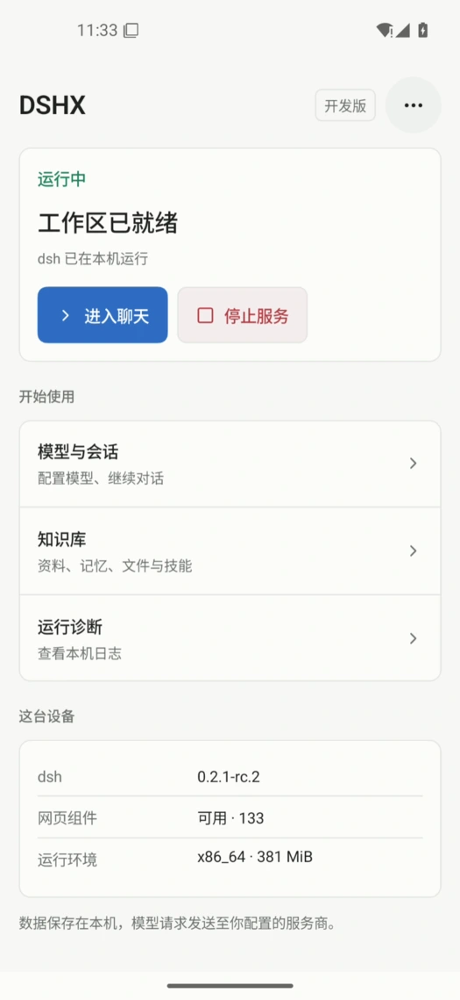](assets/readme/workbench.webp) | [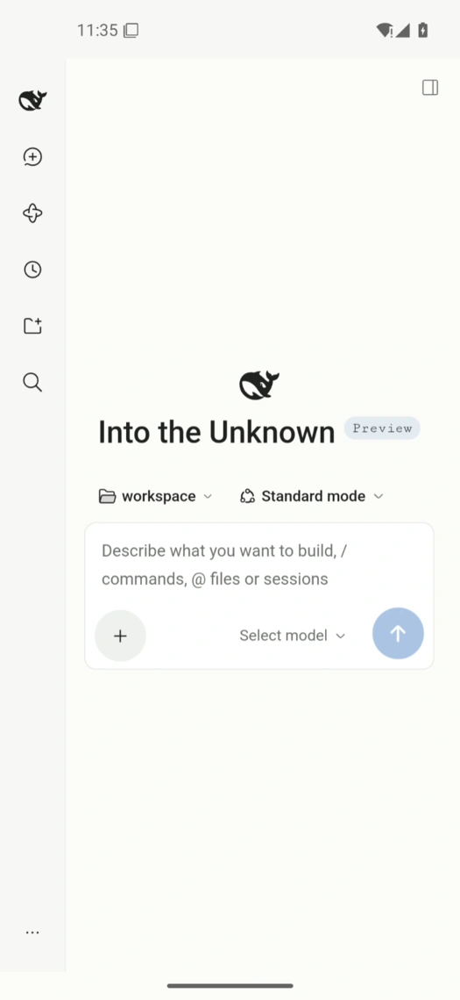](assets/readme/dialog.webp) | [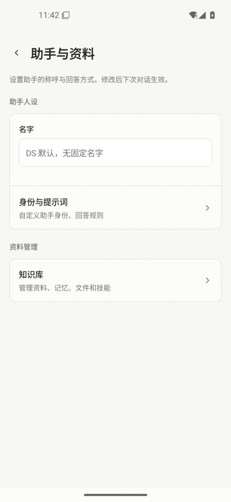](assets/readme/assistant.webp) | [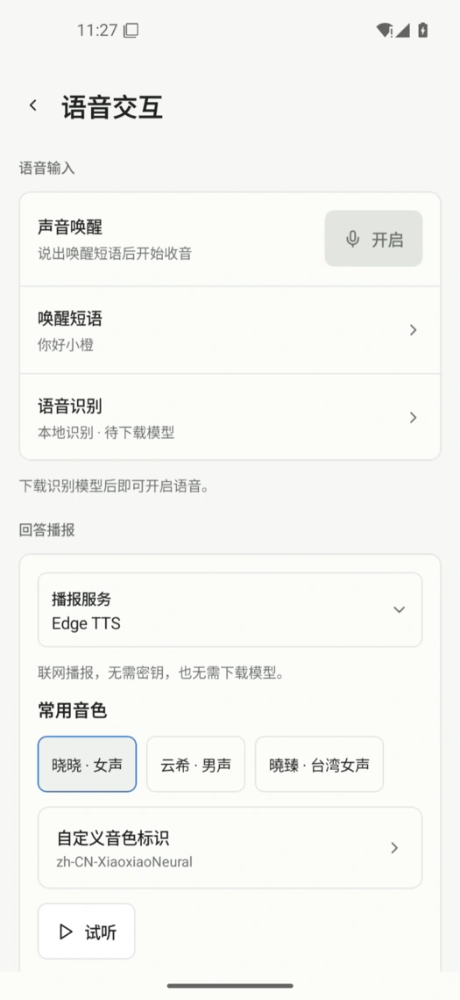](assets/readme/voice.webp) |

### 资料与文件

| 本机知识库 | 长期记忆 | 文件与附件 | 技能管理 |
| :---: | :---: | :---: | :---: |
| [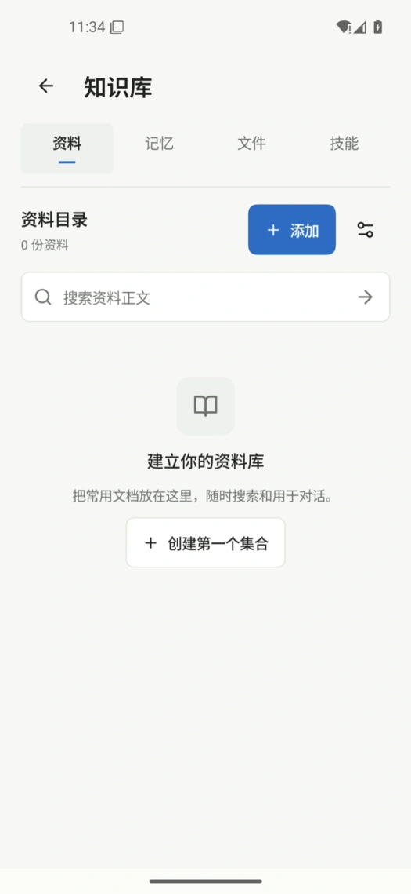](assets/readme/knowledge.webp) | [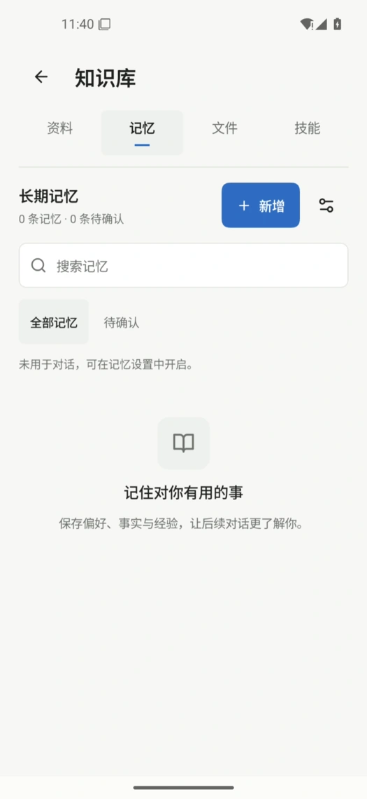](assets/readme/memory.webp) | [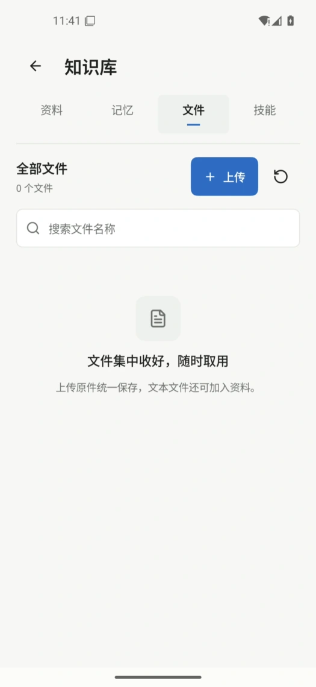](assets/readme/files.webp) | [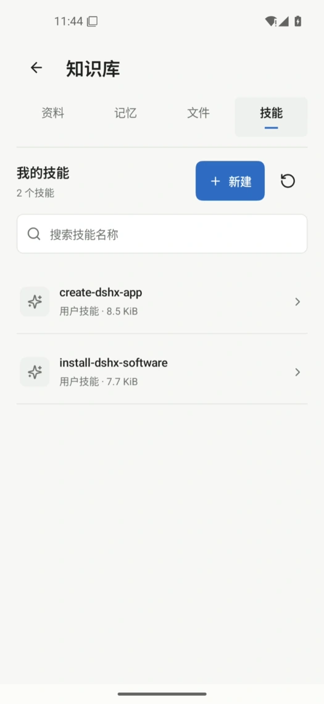](assets/readme/skills.webp) |

### 手机能力与扩展

| 手机操作 | 任务分工 | 实验体 | 微应用 | 插件 |
| :---: | :---: | :---: | :---: | :---: |
| [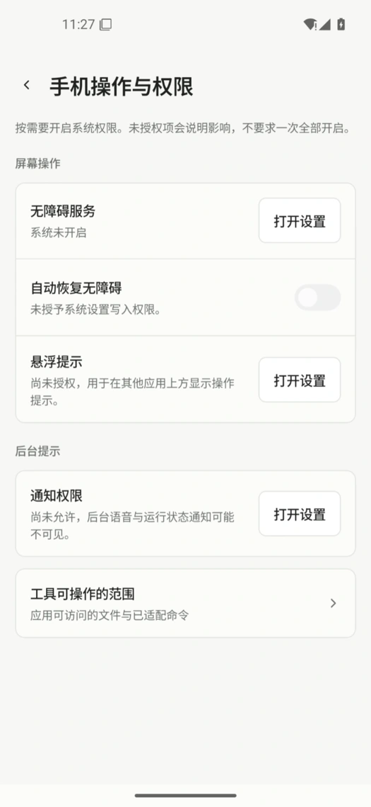](assets/readme/phone-control.webp) | [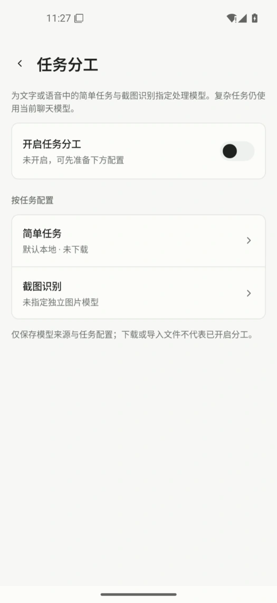](assets/readme/task-routing.webp) | [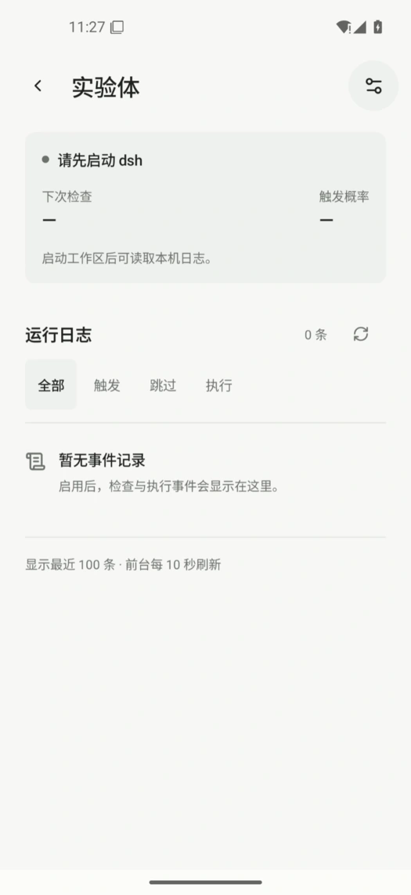](assets/readme/specimen.webp) | [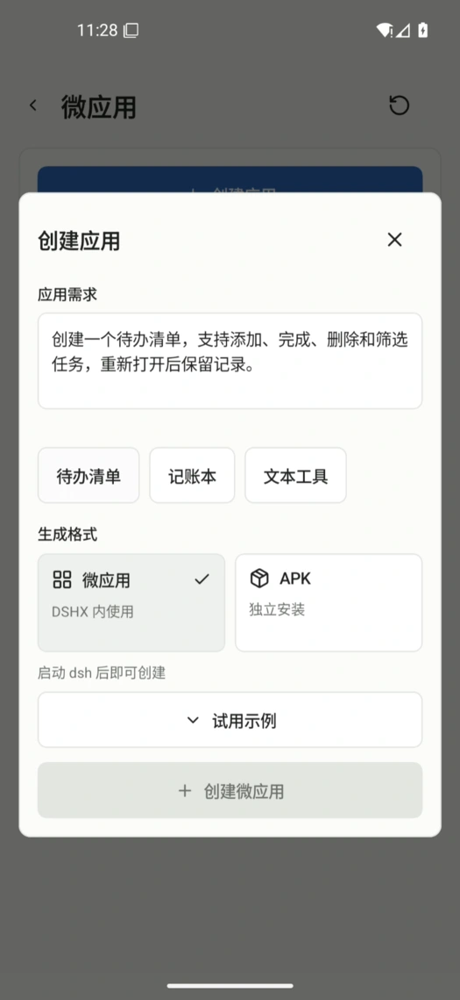](assets/readme/micro-apps.webp) | [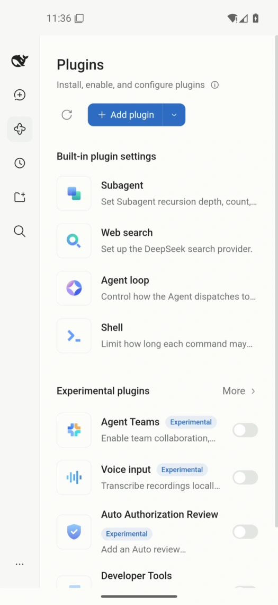](assets/readme/plugins.webp) |

### 跨网络聊天与网页共享

| 跨网络聊天列表 | 聊天中的 AI 接待 | 添加共享网页 |
| :---: | :---: | :---: |
| [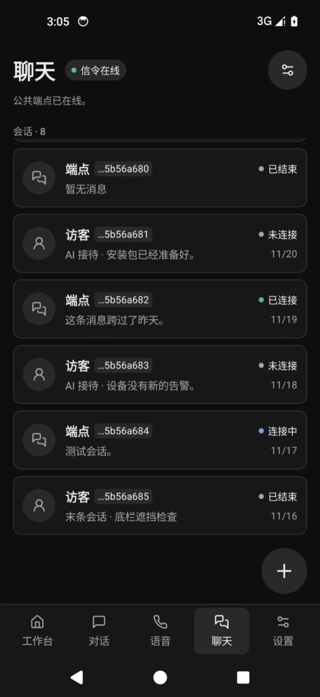](assets/readme/tunnel-inbox.webp) | [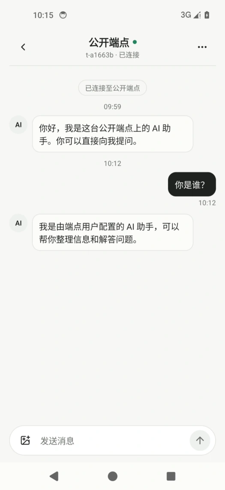](assets/readme/tunnel-conversation.webp) | [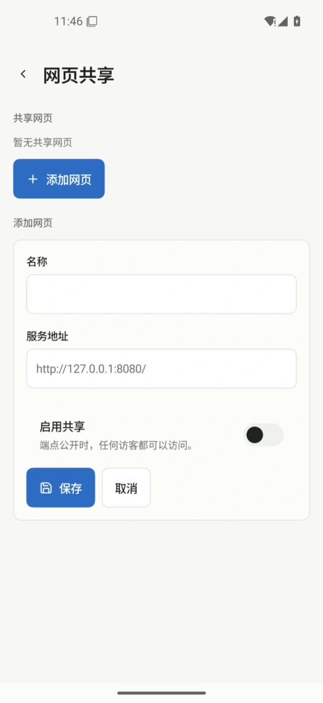](assets/readme/web-share.webp) |

**网页共享目录。** 端点是由 DSHX 注册的对外入口，平台维护的目录可以找到公开的端点。同一个端点可以分享多个网页。

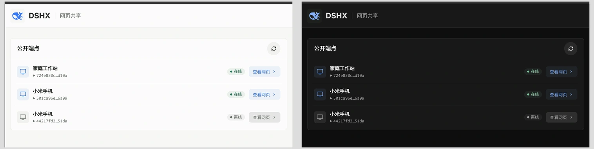

**直接打开共享网页。** 通过分享链接打开后，浏览器内容区只显示发布者的网页，没有 DSHX 导航或连接状态栏。下图是从链接打开的测试网页。


### 应用管理

| 外观 | 备份与恢复 | 应用内更新 | 运行诊断 |
| :---: | :---: | :---: | :---: |
| [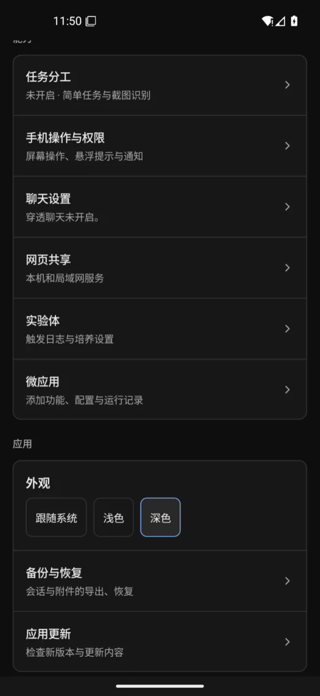](assets/readme/appearance.webp) | [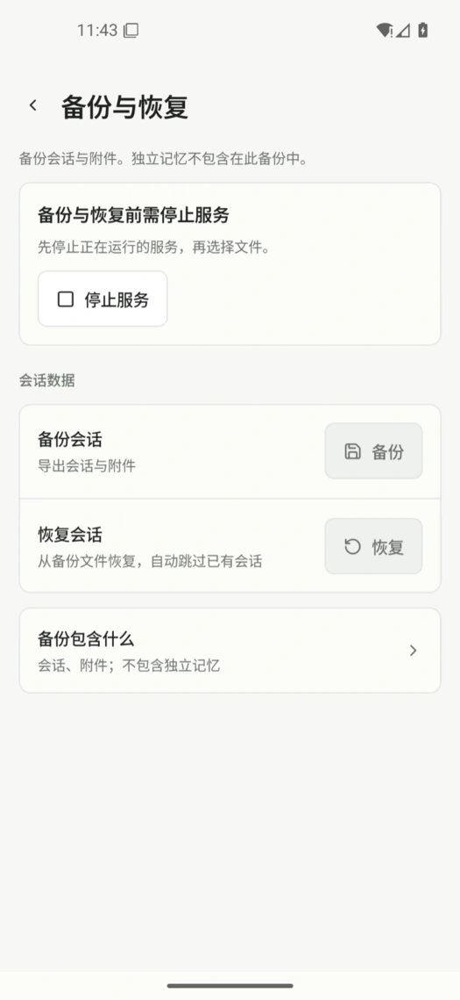](assets/readme/backup.webp) | [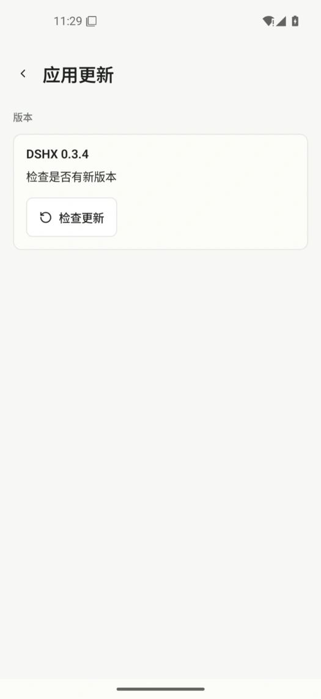](assets/readme/update.webp) | [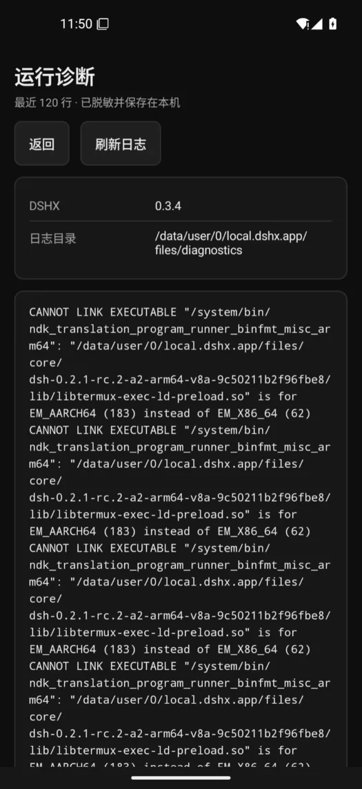](assets/readme/diagnostics.webp) |

<a id="当前状态"></a>

## 近期更新

本文涵盖至 **[v0.3.4 开发预览](https://github.com/skynit/DSHX/releases/tag/v0.3.4)**。各版本的提交见 [GitHub 发行记录](https://github.com/skynit/DSHX/releases)。

| 版本 | 改动 |
| --- | --- |
| 0.3.4 | 分享链接直接打开发布者网页，也可以分享某个指定网页。独立网页目录支持明暗主题，并区分空列表和断线状态。 |
| 0.3.3 | 新增手机本机和局域网网页共享，先直连，平台配置中继后可在直连失败时由服务器转发加密流量。dsh 可创建共享草稿。穿透聊天新增文件附件、直连或中继标记和往返延迟，文字与附件分开传输；旧版聊天协议不再兼容。 |
| 0.3.1–0.3.2 | 调整聊天列表和详情，发现入口移至右下角加号；更新下载交给 Android 后台调度，支持断点续传。新增「DSHX 引擎」系统快捷开关与可选无障碍恢复，后者默认关闭并需额外授权。 |
| 0.3.0 | 新增跨设备文字和图片聊天、公开端点发现、AI 接待与人工接管，以及可独立部署的穿透平台。随包提供轻量 Java 应用编译和签名工具，可在手机上生成安装包。 |
| 0.2.0 | 新增本机语音识别；可在 dsh 对话中创建微应用，并导出独立 Android 安装包。 |

<a id="开始使用"></a>
<a id="安装与构建"></a>
<a id="构建与定向验证"></a>

## 快速开始

### 安装或更新

首次安装，从 [v0.3.4 发布页](https://github.com/skynit/DSHX/releases/tag/v0.3.4)下载 ARM64 版 APK（Android 安装包）。这是面向使用 64 位 ARM 处理器的手机的版本，不是 x86_64 模拟器包。

已安装带更新功能的版本时，打开「设置 → 应用更新」，检查新版、下载并交给系统安装器确认。离开更新页面不会取消下载；系统暂停或网络中断后可续传。详见[应用内更新](docs/update.md)。

### 设备要求

项目声明最低 Android 8.0（API 26，即 Android 系统接口版本），部分能力另有更高系统要求。文字对话页需要 **Android System WebView 126 或更新版本**：它是 Android 提供、由应用创建的网页容器，负责显示 dsh 的对话页面，处理模型请求的则是引擎。设备兼容性仍需按具体机型验证。

语音输入默认在手机上使用 **Silero VAD + SenseVoice**：前者检测讲话和停顿，后者把语音片段转换为文字。首次需在“设置 → 语音交互 → 语音识别”下载约 229 MiB 模型，此后录音在本机处理，单次讲话限 30 秒。也可选择手机提供的系统识别服务，其联网需求取决于该服务。关键词唤醒独立运行；回答播报使用在线服务，需要网络。

安装后可直接[启动并配置](#启动并配置)。没有适用的安装包或需要调试时，再从源码构建。

### 从源码构建

以下命令面向 **Linux 开发机与 ARM64 手机**，在仓库根目录执行。开发环境需要：

- **JDK 17**：编译 Java/Kotlin 的工具集。
- **Android SDK 36**：Android 系统接口及构建工具；另安装 **NDK `28.2.13676358`** 和 **CMake `3.22.1`**，用于编译和组织 C/C++ 原生库。
- **Python 3.11+、Node.js、npm、curl、dpkg-deb、readelf**，以及 `/usr/include/node/node_api.h` 头文件。

在本地 `local.properties` 中填写实际 SDK 路径，例如 `sdk.dir=/你的/Android/Sdk`，该文件由 Git 忽略。必要时通过 `ANDROID_NDK_HOME` 指定 NDK 路径。准备好环境后执行：

```bash
# 准备语音运行库、唤醒资源和本机推理源码。
python3 tools/voice.py prepare

# 为 ARM64 手机生成 dsh 及 Android 适配运行包。
python3 tools/core.py build --abi arm64-v8a

# 按本机 JDK 位置调整 JAVA_HOME。
JAVA_HOME=/usr/lib/jvm/java-17-openjdk ./gradlew :app:assembleDebug
```

首次准备会联网下载锁定依赖，无需聊天模型密钥。生成的安装包位于 `app/build/outputs/apk/debug/app-debug.apk`。x86_64 模拟器需将运行包参数改为 `--abi x86_64`，再重新构建 APK；每个 APK 只包含所选架构的运行资源。

使用 `adb`（Android SDK 提供的设备连接与安装工具）时，连接设备并授权调试，只有一个目标设备时执行：

```bash
adb devices
adb install -r app/build/outputs/apk/debug/app-debug.apk
```

多设备选择、依赖准备和定向测试见[构建、安装与验证](docs/development.md)。

### 单独构建穿透平台

穿透平台是独立于 Android 安装包的服务，负责注册和发现端点、帮设备建立跨网络连接，也提供浏览器访问共享网页的入口。Android 默认使用 `https://dshx-tunnel.filesharing.asia:8443`，也可以连接自建平台。在仓库根目录执行：

```bash
python3 tools/tunnel.py build
```

产物为 `build/dshx-tunnel-platform.tar.gz`，包含浏览器入口，无需单独构建前端。解包启动、连接配置和可选中继见[穿透聊天](docs/tunnel-chat.md#打包和运行穿透平台)；自建网页访问需要独立应用域名及 HTTPS，见[网页共享部署](docs/web-share.md#平台部署)。

<a id="第一次对话"></a>

### 启动并配置

1. 打开 DSHX，应用通常会在后台启动 dsh。若尚未运行，或之前手动停过，在工作台点「启动 dsh」，等待工作区就绪。
2. 在工作台打开「模型与会话」，也可以通过「页面导航 → 对话」进入同一页面。配置自己的模型服务地址、模型名称和所需凭据。云端模型需要联网，费用由所选服务决定。
3. 发送下面的消息，确认当前会话中出现实际模型回答：

   ```text
   你好，请用一句话介绍你能做什么。
   ```

4. 按需进入「设置」：在「语音交互」下载本机识别模型或改用系统识别，并配置播报；在「任务分工」为简单任务和截图配置模型；在「手机操作与权限」开启所需能力并完成系统授权。在「助手与资料 → 知识库」可以管理资料、记忆、文件和技能。

引擎启动、文字对话页加载和模型回答是三个独立检查点。首次使用以实际收到回答为准。底栏的「聊天」用于跨设备通信，不是配置模型的入口。

<a id="术语与整体架构"></a>
<a id="典型执行流程"></a>

## 工作原理

**会话**由 dsh 创建，保存一段对话与工具事件；**工具**是引擎注册给模型的命名操作，模型提出名称和参数后，由程序执行并把结果返回。Android 应用管理引擎运行，并通过本机通信连接交接手机操作等请求。

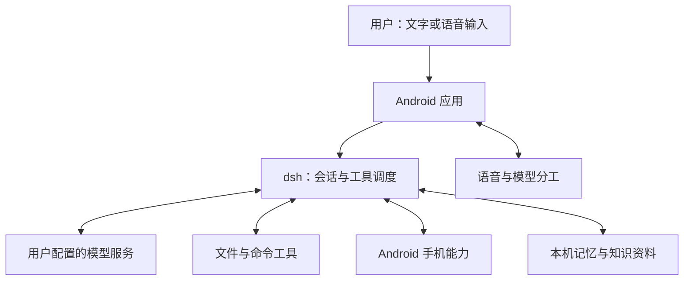

文字从对话页面进入 dsh。语音默认由 DSHX 录音并在本机识别，也可以交给选定的 Android 系统识别服务；两种方式都把识别后的文字交给当前会话。配置任务分工后，符合规则的简单任务可交给另选的本机或在线模型。dsh 请求模型，收到工具调用后执行对应操作，再把结果交给模型继续处理。语音页逐步显示回答，把可朗读文字按短句交给所选播报服务；思考内容和工具参数不会进入播报。手机工具由 Android 应用执行，执行前仍需检查能力开关和系统授权。

长期记忆保存用户管理或自动整理得到的偏好、事实和经验；知识库保存用户主动导入的参考资料。它们与完整对话记录分别存储，按需要提供有限背景或检索结果。谁创建各组件、请求如何流转以及数据如何保存，见[术语与整体架构](docs/architecture.md)和[典型执行流程](docs/workflows.md)。

<a id="能做什么"></a>
<a id="模块职责与工作原理"></a>

## 功能一览

| 功能 | 用途与条件 | 预览 |
|---|---|---|
| 工作台 | 查看引擎状态、启动或停止 dsh，进入模型与会话；[引擎管理](docs/engine.md) | [截图](assets/readme/workbench.webp) |
| 文字对话 | 配置模型后发起多轮对话，查看会话记录与工具结果；[对话界面](docs/interface.md) | [截图](assets/readme/dialog.webp) |
| 助手设置 | 自定义助手的名字、身份和回答要求；[助手设置](docs/assistant.md) | [截图](assets/readme/assistant.webp) |
| 语音对话 | 默认在本机识别，可选系统识别，支持关键词唤醒、逐段播报和打断。输入需麦克风权限，本机识别首次需下载模型；播报需联网，默认使用 Edge TTS（把文字转为语音的在线服务），也可配置火山服务；[语音说明](docs/voice.md) | [截图](assets/readme/voice.webp) |
| 本机知识库 | 导入 UTF-8 编码的 Markdown 或 TXT 文档。本机可按关键词查找；按语义查找或生成摘要需另配服务，可能向所选服务发送资料；[知识库](docs/knowledge.md) | [截图](assets/readme/knowledge.webp) |
| 长期记忆 | 保存偏好、事实与经验。允许对话使用记忆和开启自动整理是两个独立开关，默认均关闭；新自动整理的条目直接保存，「待确认」主要用于旧候选；[记忆说明](docs/memory.md) | [截图](assets/readme/memory.webp) |
| 文件、命令与附件 | 在知识库管理上传原件和聊天附件；助手可在应用已有权限内读写文件、搜索或执行前台命令，用户也可使用手动终端；[文件与工具](docs/tools.md) | [截图](assets/readme/files.webp) |
| 技能管理 | 用户可以创建、编辑和删除技能。技能是给 dsh 读的操作说明，不是插件，也不会增加系统权限；[技能说明](docs/interface.md#知识库统一入口) | [截图](assets/readme/skills.webp) |
| 手机操作 | 查找可见应用、读取页面控件、点击或滑动。需开启对应能力并完成系统授权；读取和操作界面还需无障碍服务已连接；[手机能力](docs/phone.md) | [截图](assets/readme/phone-control.webp) |
| 任务分工 | 简单文字或语音任务可另选本机或在线模型；本机模型须先下载或导入。截图识别可单独指定支持图片的模型；[模型分工](docs/voice.md#自定义分工模型) | [截图](assets/readme/task-routing.webp) |
| 实验体 | 用户配置指令和触发概率，dsh 在设备可操作时检查是否执行，并记录结果。默认关闭；锁屏或息屏跳过，恢复后不补跑；[实验体说明](docs/hosting.md) | [截图](assets/readme/specimen.webp) |
| 微应用 | 描述需求，由 dsh 生成能在 DSHX 内运行的应用，或选择生成可独立安装的 Android 安装包；[微应用说明](docs/apps.md) | [截图](assets/readme/micro-apps.webp) |
| 插件 | 用 dsh 管理器安装和启用扩展。能安装、已启用和工具能在 Android 上实际运行是三回事；[插件说明](docs/plugins.md) | [截图](assets/readme/plugins.webp) |
| 穿透聊天 | 设备跨网收发文字、图片和文件，支持 AI 接待与人工接管。双方用同一穿透平台，优先直连；配置中继后，直连失败可由服务器转发加密数据；[聊天说明](docs/tunnel-chat.md) | [截图](assets/readme/tunnel-conversation.webp) |
| 网页共享 | 将手机或局域网内已运行的网页分享给浏览器访客。端点需公开在线、网页条目需启用；访客不用安装 DSHX；[网页共享说明](docs/web-share.md) | [发布端](assets/readme/web-share.webp) · [访客端](assets/readme/web-direct.webp) |
| 外观 | 在设置中选择跟随系统、浅色或深色；[界面说明](docs/interface.md) | [截图](assets/readme/appearance.webp) |
| 备份与归档 | 停止引擎后可备份或恢复会话与附件；知识归档另在资料管理中操作。两者均不包含独立记忆或模型密钥；[备份范围](docs/backup.md) | [截图](assets/readme/backup.webp) |
| 应用内更新 | 检查版本，在后台下载并验证安装包，支持断点续传；安装需到 Android 系统安装器确认；[更新说明](docs/update.md) | [截图](assets/readme/update.webp) |
| 运行诊断 | 从工作台查看保存在本机的近期日志，用来排查引擎启动等问题；[引擎说明](docs/engine.md) | [截图](assets/readme/diagnostics.webp) |

Full（完全权限）是应用为有效会话提供的工具准入模式，只使用应用已有的访问权限；它不授予 root（系统最高权限），也不替代 Android 系统授权。

## 使用场景

以下是可以尝试的任务示例，执行效果取决于所选模型、实际资料和设备权限。

### 分享网页

1. **开启发布入口。** 启动 dsh，在「设置 → 聊天设置」开启「穿透聊天」、关闭隐身并保存，等端点显示在线。
2. **登记服务。** 在「设置 → 网页共享 → 添加网页」填写已运行的服务地址。手机本机服务可填 `http://127.0.0.1:8080/`；转发同一局域网内另一台设备的服务可填它的固定地址，如 `http://192.168.1.20:8080/`。确认要公开后，打开「启用共享」并保存。
3. **发送或打开链接。** 点击「复制端点网页链接」，访客用浏览器打开后会进入第一个可访问的网页。要分享指定网页，从[默认平台的网页共享目录](https://dshx-tunnel.filesharing.asia:8443/web/)选择端点，打开目标网页后复制浏览器地址。Android 访客也可以在「聊天」页点击右下角加号，找到对应端点后点「查看网页」。

也可以在「对话」里请 dsh「做一个可共享的活动公告页」。内置技能能运行一个网页服务或登记已有服务，但只保存停用草稿，不会替你公开。

**公开前请确认访问范围。** 端点公开在线时，任何访客都能访问已启用服务的页面和接口；登记的首页路径不是访问限制。不要共享没有自身登录保护的管理后台。停用条目或切换为隐身可撤回共享；更换网络或重启 DSHX 后，局域网条目需要重新保存确认。

平台在浏览器注册 Service Worker（接管共享网页请求的后台脚本），把请求交给发布设备；发布者无需修改自己的网页。依赖站点自带 Service Worker 的应用不支持。详见[兼容范围](docs/web-share.md#连接与兼容边界)。

### 跨网络聊天

两台 Android 设备使用同一穿透平台，在「设置 → 聊天设置」启用穿透聊天，并保持引擎运行。在「聊天」页点击右下角加号，从「发现」选择公开端点，点击「发起聊天」。连通后可以发送文字、图片或文件；聊天标题旁会显示实际连接方式，有可用数据时也会显示往返延迟。

接收方配置好模型后可用 AI 自动接待，也可以随时发送消息接管。远端聊天不会自动取得本机记忆、知识库、文件或手机操作权限。附件格式与限制见[图片和文件](docs/tunnel-chat.md#图片和文件)。

### 连续语音对话与打断

在“设置 → 语音交互”准备本机识别模型，或确认所选系统识别服务可用，并试听播报。启动 dsh、配置聊天模型后，通过“页面导航 → 语音”开始对话，按提示授予麦克风权限，等页面显示“正在听”再说问题。

识别完成后立即显示你的文字，助手回答随后逐步补入，并按短句播报。“语音打断”默认开启：确认新的讲话内容后停止上一轮回答，并继续收取本次问题；也可点击麦克风“打断回答”。系统识别服务是否支持中间文字、扬声器回声及设备环境都会影响自动打断效果。结束语音或切换到文字对话会停止录音、合成与播放。火山音频生成服务需等待每段完整音频，延迟与 Edge 的分块播放不同。详见[语音与播报](docs/voice.md)。

### 整理文件并交付结果

```text
读取我提供的这份笔记，整理为待办清单，保存成 Markdown 文件并交给我。
```

助手通过文件工具读取和写入，生成的文件可作为附件交付。文件访问、前台命令与用户直接操作的终端有不同入口，见[文件与工具](docs/tools.md)。

### 从自己的资料中查找答案

在知识库中导入一份包含备份步骤的 Markdown 笔记后，询问：

```text
这份笔记中关于备份的步骤是什么？请给出资料引用。
```

关键词查找在本机执行；语义检索需用户指定的嵌入模型，把文字转成便于比较语义的一组数字，它与生成回答的模型用途不同。摘要也需单独配置。见[知识资料与检索](docs/knowledge.md)。

### 让助手协助操作手机

启用所需手机能力并完成系统授权后，可以尝试：

```text
查找手机上可用的计算器应用，打开它，再告诉我当前页面有哪些可操作的控件。
```

应用查找只覆盖 Android 对 DSHX 可见的应用；读取控件需要有效的无障碍服务连接。无障碍服务由用户在系统设置中启用，向应用提供可见控件和允许的界面动作。见[手机能力与操作流程](docs/phone.md)。

<a id="数据目录与备份范围"></a>
<a id="数据与模型服务"></a>

## 常见问题

<details>
<summary><strong>DSHX 能完全离线使用吗？</strong></summary>

普通对话请求用户配置的模型服务。本机语音识别模型下载完成后可离线识别；选择 Android 系统识别时，是否联网取决于系统服务。有限的简单文字任务可在对应模型准备好后本地执行。回答播报、跨网络聊天和网页共享需要网络。详见[语音说明](docs/voice.md)。

</details>

<details>
<summary><strong>数据保存在手机上，还会发送给模型服务吗？</strong></summary>

会话、附件、记忆、资料和下载的模型保存在应用私有目录。普通对话内容仍发送给所选模型服务；开启自动记忆整理后，相关对话片段可能发送给来源模型，知识嵌入和摘要也可能发送所选资料。长期记忆和自动整理默认关闭，相关服务按功能独立配置。见[记忆](docs/memory.md)、[知识库](docs/knowledge.md)和[数据存储](docs/storage.md)。

</details>

<details>
<summary><strong>文字对话页打不开，或页面能打开但没有回答，应该检查哪里？</strong></summary>

先确认工作台中的 dsh 已启动，再检查 WebView 是否达到 126 或更新版本。页面可用但请求失败时，检查模型服务地址、模型名称、凭据与网络。见[安装与首次对话验证](docs/development.md#安装并完成第一次对话)。

</details>

<details>
<summary><strong>为什么手机操作或语音功能不可用？</strong></summary>

手机操作需要对应能力开关、系统授权；界面观察还需要无障碍服务连接。语音输入需要麦克风权限和可用的识别方式；可在「设置 → 语音交互 → 语音识别」下载本机识别模型或选择系统识别。在线播报另需网络和可用的服务配置。见[手机能力](docs/phone.md)和[语音说明](docs/voice.md)。

</details>

<details>
<summary><strong>备份包含全部应用数据吗？</strong></summary>

会话备份和知识归档覆盖各自数据，两者均不包含模型密钥和独立长期记忆。卸载或清除数据前，先核对[备份范围](docs/storage.md)与[迁移、恢复说明](docs/backup.md)。

</details>

<details>
<summary><strong>app、prototype 和 plan 分别是什么？</strong></summary>

`app/` 是正式 Android 应用；`core/` 保存引擎适配模块；`tools/` 是开发机上的构建与准备脚本。`prototype/` 是早期独立交互演示，`p0/` 是仅本地保存的早期可行性材料，正式应用不依赖它们。`docs/` 保存正式说明；`plan/` 保存本地计划、调研和实施记录。`p0/` 与 `plan/` 均由 Git 忽略。见[目录与架构](docs/architecture.md)和[原型说明](docs/prototype.md)。

</details>

<a id="模块与文档"></a>
<a id="目录与模块总览"></a>
<a id="文档索引与验收状态"></a>

## 说明文档

从[文档索引](docs/README.md)开始，按需要阅读：

- **构建与使用：** [开发环境、安装与定向验证](docs/development.md)、[聊天界面](docs/interface.md)、[助手设置](docs/assistant.md)。
- **跨设备与更新：** [网页共享](docs/web-share.md)、[穿透聊天](docs/tunnel-chat.md)、[Android 应用在线更新](docs/update.md)。
- **架构与运行：** [术语和目录](docs/architecture.md)、[典型执行流程](docs/workflows.md)、[引擎生命周期](docs/engine.md)、[运行包安装](docs/runtime.md)、[本机通信](docs/bridge.md)。
- **工具与扩展：** [文件、命令和附件](docs/tools.md)、[手机能力](docs/phone.md)、[语音与本机小模型](docs/voice.md)、[技能](docs/interface.md#知识库统一入口)、[实验体](docs/hosting.md)、[微应用](docs/apps.md)、[插件兼容](docs/plugins.md)。
- **记忆与资料：** [长期记忆](docs/memory.md)、[知识库](docs/knowledge.md)、[共享读取额度](docs/read-budget.md)。
- **数据与来源：** [存储和备份范围](docs/storage.md)、[迁移与归档](docs/backup.md)、[早期原型](docs/prototype.md)、[技术来源与许可证](docs/sources.md)。

<a id="参与开发"></a>

## 贡献

修改前先阅读[项目协作规范](AGENTS.md)、[架构说明](docs/architecture.md)和[开发说明](docs/development.md)。功能和模块原理写入 `docs/`，计划、调研与过程记录保存在本地 `plan/`。

文档使用中文。提交信息采用 `type(scope): 中文说明` 格式：类型使用 `feat`、`fix`、`docs`、`style`、`refactor`、`chore` 等英文前缀，`scope` 使用英文标明涉及的模块，冒号后的说明与提交正文使用中文，例如 `feat(knowledge): 增加文档导入`、`fix(phone): 处理无障碍服务断开`、`docs(readme): 整理项目说明`。

验证只运行当前包或改动模块的定向测试，新增测试放入已有测试文件。构建、界面检查与真实模型验证分别报告。

## 致谢

感谢 DeepSeek 官方 [deepseek-harness](https://github.com/deepseek-ai/deepseek-harness) 提供智能体引擎、聊天网页和插件机制，以及 [Soodok / DSH Mobile](https://github.com/Soodok/Deepseek-Harness-Local-Android) 的 Android 实践参考。依赖版本、语音模型和其他来源见[技术来源与许可证](docs/sources.md)。

<a id="致谢与许可"></a>

## 许可证

项目自有源码采用 [MIT License](LICENSE)。参考项目的 [MIT 许可原文](licenses/DSH-Mobile-LICENSE.txt) 单独保留，第三方依赖和模型继续适用各自许可证。
