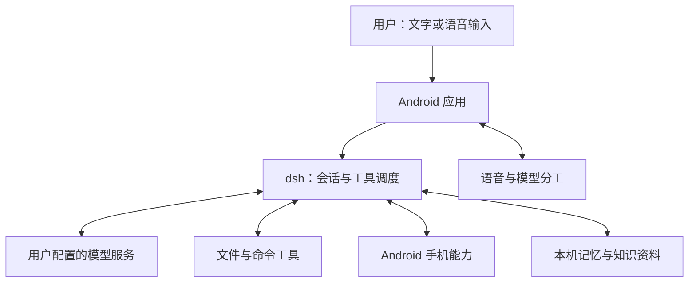

<div align="center">

# DSHX

**在 Android 上使用 DeepSeek 官方智能体引擎的 AI 助手。**

文字与语音交互 · 手机工具 · 长期记忆 · 本机知识库

[](#当前状态)
[](#设备要求)
[](LICENSE)

**[快速开始](#快速开始) · [工作原理](#工作原理) · [功能一览](#功能一览) · [使用场景](#使用场景) · [常见问题](#常见问题) · [说明文档](#说明文档)**

</div>

---

想让手机上的助手读取文件、操作应用，并在后续对话中使用你保存的偏好和资料？DSHX 将这些能力放进同一个 Android 应用，提供文字聊天、语音入口和原生管理页面。

DSHX 将 DeepSeek 官方 **deepseek-harness（简称 dsh）** 移植到 Android。dsh 是随应用提供、由应用启动的智能体引擎，负责模型请求、对话记录和工具调度；DSHX 的 Android 应用负责页面、引擎启停、系统权限及手机、本地语音等能力。普通对话使用你配置的模型服务，本机保存数据与本地模型各有独立用途。

<a id="当前状态"></a>

> [!NOTE]
> 当前版本为 **`0.1.0-dev`，开发调试版本**，尚未完成正式发布验收。功能接入情况与真实模型、设备验证范围分别说明，见[当前验证边界](docs/README.md#当前验证边界)。

<a id="开始使用"></a>
<a id="安装与构建"></a>
<a id="构建与定向验证"></a>

## 快速开始

### 设备要求

项目声明最低 Android 8.0（API 26，即 Android 系统接口版本），部分能力另有更高系统要求。聊天页需要 **Android System WebView 126 或更新版本**：它是 Android 提供、由应用创建的网页容器，负责显示 dsh 的聊天页面，与处理请求的引擎分别运行。设备兼容性仍需按具体机型验证。

语音输入还需要手机安装并启用**系统语音识别服务**：它由系统或用户安装的语音应用提供，DSHX 通过 Android 标准接口调用，负责收音、判断讲话结束并返回文字；是否联网取决于该服务。它与 DSHX 自带、只负责检测唤醒短语的本机关键词模型分别工作。应用不再下载整句语音识别模型；播报使用在线服务，需要网络。

已有与设备架构匹配的 APK（Android 安装包）时，安装后直接进入[启动并配置](#启动并配置)。从源码生成开发包时，按下面的步骤操作。

### 从源码构建

以下命令面向 **Linux 开发机与 ARM64 手机**，在仓库根目录执行。开发环境需要：

- **JDK 17**：编译 Java/Kotlin 的工具集。
- **Android SDK 36**：Android 系统接口及构建工具；另安装 **NDK `28.2.13676358`** 和 **CMake `3.22.1`**，用于编译和组织 C/C++ 原生库。
- **Python 3.11+、Node.js、npm、curl、dpkg-deb、readelf**，以及 `/usr/include/node/node_api.h` 头文件。

在本地 `local.properties` 中填写实际 SDK 路径，例如 `sdk.dir=/你的/Android/Sdk`，该文件由 Git 忽略。必要时通过 `ANDROID_NDK_HOME` 指定 NDK 路径。准备好环境后执行：

```bash
# 准备语音运行库、唤醒资源和本机推理源码。
python3 tools/voice.py prepare

# 为 ARM64 手机生成 dsh 及 Android 适配运行包。
python3 tools/core.py build --abi arm64-v8a

# 按本机 JDK 位置调整 JAVA_HOME。
JAVA_HOME=/usr/lib/jvm/java-17-openjdk ./gradlew :app:assembleDebug
```

首次准备会联网下载锁定依赖，无需聊天模型密钥。生成的安装包位于 `app/build/outputs/apk/debug/app-debug.apk`。x86_64 模拟器需将运行包参数改为 `--abi x86_64`，再重新构建 APK；每个 APK 只包含所选架构的运行资源。

使用 `adb`（Android SDK 提供的设备连接与安装工具）时，连接设备并授权调试，只有一个目标设备时执行：

```bash
adb devices
adb install -r app/build/outputs/apk/debug/app-debug.apk
```

多设备选择、依赖准备和定向测试见[构建、安装与验证](docs/development.md)。

<a id="第一次对话"></a>

### 启动并配置

1. 打开 DSHX，在“工作台”点击“启动 dsh”。应用校验并安装随包提供的运行文件，然后启动引擎。
2. 在工作台点击“页面导航”，选择“对话”，配置自己的模型服务地址、模型名称和所需凭据。云端模型需要联网，费用由所选服务决定。
3. 发送下面的消息，确认当前会话中出现实际模型回答：

   ```text
   你好，请用一句话介绍你能做什么。
   ```

4. 按需进入“设置”：在“语音交互”检查系统识别与播报，在“任务分工”配置可选的小模型，在“手机操作与权限”开启手机能力，在“助手与资料 → 知识库”管理资料、记忆、文件和技能。可选本机文字模型仍需下载并校验；播报默认使用 Edge TTS，也可配置火山语音合成或音频生成，无需下载播报模型。

引擎启动、聊天网页加载和模型回答是三个独立检查点。首次使用以实际收到回答为准。

<a id="术语与整体架构"></a>
<a id="典型执行流程"></a>

## 工作原理

**会话**由 dsh 创建，保存一段对话与工具事件；**工具**是引擎注册给模型的命名操作，模型提出名称和参数后，由程序执行并把结果返回。Android 应用管理引擎运行，并通过本机通信连接交接手机操作等请求。



文字从聊天页面进入 dsh；语音由手机系统服务收音、识别后交给正式会话，有限的简单文字任务也可按规则交给本机小模型。dsh 请求配置的模型，收到工具调用后执行对应操作，再将结果交给模型继续处理，最终返回回答。语音页逐步显示回答，并把可朗读文字按短句交给所选播报服务；思考内容和工具参数不会进入播报。手机工具通过本机通信转交 Android 应用执行，执行前仍需检查能力开关与系统授权。

长期记忆保存用户管理或自动整理得到的偏好、事实和经验；知识库保存用户主动导入的参考资料。它们与完整对话记录分别存储，按需要提供有限背景或检索结果。谁创建各组件、请求如何流转以及数据如何保存，见[术语与整体架构](docs/architecture.md)和[典型执行流程](docs/workflows.md)。

<a id="能做什么"></a>
<a id="模块职责与工作原理"></a>

## 功能一览

| 能力 | 当前用途 | 使用条件与说明 |
|---|---|---|
| 文字聊天与助手设置 | 多轮对话，自定义助手名字、身份和回答要求 | 配置模型服务；[界面](docs/interface.md) · [助手设置](docs/assistant.md) |
| 文件、命令与附件 | 读写文件、搜索内容、执行前台命令、交付附件，并保留用户手动终端 | 使用应用已有访问权限；[文件与工具](docs/tools.md) |
| 手机操作 | 28 个手机工具，覆盖应用查找、界面观察与操作、分享和设备能力 | 对应能力开关与系统授权；[手机能力](docs/phone.md) |
| 语音对话 | 系统语音识别、本机关键词唤醒、回答逐段播报，以及语音或按钮打断 | 需系统识别服务与麦克风权限；默认使用 Edge TTS，火山需自行配置凭据与开通服务，播报均需联网；[语音说明](docs/voice.md) |
| 任务分工 | 简单语音任务使用默认本地、导入本地或在线模型；截图可单独指定图片模型 | 本机文字模型需下载或导入，截图理解需支持图片的服务；[模型分工](docs/voice.md#自定义分工模型) |
| 长期记忆 | 保存、管理和召回偏好、事实与经验，按需自动整理 | 长期记忆和自动整理默认关闭；[记忆说明](docs/memory.md) |
| 本机知识库 | 导入 UTF-8 编码的 Markdown、TXT，进行关键词与语义检索 | 关键词检索在本机，语义检索和摘要需另配服务；[知识库](docs/knowledge.md) |
| 备份与归档 | 分别导出会话数据和知识资料，用于恢复或迁移 | 两种格式覆盖不同数据；[存储范围](docs/storage.md) · [归档说明](docs/backup.md) |
| 微应用 | 在手机内让 dsh 创建带页面、逻辑和独立数据的应用，支持可选后台入口 | 在 DSHX 内打开；手机能力按需授权；[微应用说明](docs/apps.md) |
| 插件 | 复用官方插件安装、启用和工具扩展机制 | 需满足 Android 兼容与工具调用条件；[插件说明](docs/plugins.md) |

Full（完全权限）是应用为有效会话提供的工具准入模式，只使用应用已有的访问权限；它不授予 root（系统最高权限），也不替代 Android 系统授权。

## 使用场景

以下是可以尝试的任务示例，执行效果取决于所选模型、实际资料和设备权限。

### 连续语音对话与打断

在“设置 → 语音交互”确认系统识别服务可用，并保存、试听播报设置。启动 dsh、配置聊天模型后，通过“页面导航 → 语音”开始对话，按提示授予麦克风权限，等页面显示“正在听”再说问题。

识别完成后立即显示你的文字，助手回答随后逐步补入，并按短句播报。“语音打断”默认开启：确认新的讲话内容后停止上一轮回答，并继续收取本次问题；也可点击麦克风“打断回答”。系统识别服务是否支持中间文字、扬声器回声及设备环境都会影响自动打断效果。结束语音或切换到文字对话会停止录音、合成与播放。火山音频生成服务需等待每段完整音频，延迟与 Edge 的分块播放不同。详见[语音与播报](docs/voice.md)。

### 整理文件并交付结果

```text
读取我提供的这份笔记，整理为待办清单，保存成 Markdown 文件并交给我。
```

助手通过文件工具读取和写入，生成的文件可作为附件交付。文件访问、前台命令与用户直接操作的终端有不同入口，见[文件与工具](docs/tools.md)。

### 从自己的资料中查找答案

在知识库中导入一份包含备份步骤的 Markdown 笔记后，询问：

```text
这份笔记中关于备份的步骤是什么？请给出资料引用。
```

关键词查找在本机执行；语义检索需用户指定的嵌入模型，把文字转成便于比较语义的一组数字，它与生成回答的模型用途不同。摘要也需单独配置。见[知识资料与检索](docs/knowledge.md)。

### 让助手协助操作手机

启用所需手机能力并完成系统授权后，可以尝试：

```text
查找手机上可用的计算器应用，打开它，再告诉我当前页面有哪些可操作的控件。
```

应用查找只覆盖 Android 对 DSHX 可见的应用；读取控件需要有效的无障碍服务连接。无障碍服务由用户在系统设置中启用，向应用提供可见控件和允许的界面动作。见[手机能力与操作流程](docs/phone.md)。

<a id="数据目录与备份范围"></a>
<a id="数据与模型服务"></a>

## 常见问题

<details>
<summary><strong>DSHX 能完全离线使用吗？</strong></summary>

普通对话请求用户配置的模型服务。语音识别通过 Android 通用接口调用手机的系统服务，是否联网取决于该服务。有限简单文字任务可在对应文字模型准备好后本地执行。回答文字发送至用户选定的 Edge TTS 或火山引擎进行在线播报；本机小模型的任务范围见[语音说明](docs/voice.md)。

</details>

<details>
<summary><strong>数据保存在手机上，还会发送给模型服务吗？</strong></summary>

会话、附件、记忆、资料和下载的模型保存在应用私有目录。普通对话内容仍发送给所选模型服务；开启自动记忆整理后，相关对话片段可能发送给来源模型，知识嵌入和摘要也可能发送所选资料。长期记忆和自动整理默认关闭，相关服务按功能独立配置。见[记忆](docs/memory.md)、[知识库](docs/knowledge.md)和[数据存储](docs/storage.md)。

</details>

<details>
<summary><strong>聊天页打不开，或页面能打开但没有回答，应该检查哪里？</strong></summary>

先确认工作台中的 dsh 已启动，再检查 WebView 是否达到 126 或更新版本。页面可用但请求失败时，检查模型服务地址、模型名称、凭据与网络。见[安装与首次对话验证](docs/development.md#安装并完成第一次对话)。

</details>

<details>
<summary><strong>为什么手机操作或语音功能不可用？</strong></summary>

手机操作需要对应能力开关、系统授权；界面观察还需要无障碍服务连接。语音输入需要可用的系统识别服务和麦克风权限，可在“设置 → 语音交互”检查并进入系统设置；在线播报另需网络和可用的服务配置。本机关键词唤醒与可选文字模型分别准备，不再提供整句识别模型下载。见[手机能力](docs/phone.md)和[语音说明](docs/voice.md)。

</details>

<details>
<summary><strong>备份包含全部应用数据吗？</strong></summary>

会话备份和知识归档覆盖各自数据，两者均不包含模型密钥和独立长期记忆。卸载或清除数据前，先核对[备份范围](docs/storage.md)与[迁移、恢复说明](docs/backup.md)。

</details>

<details>
<summary><strong>app、prototype 和 plan 分别是什么？</strong></summary>

`app/` 是正式 Android 应用；`core/` 保存引擎适配模块；`tools/` 是开发机上的构建与准备脚本。`prototype/` 是早期独立交互演示，`p0/` 是仅本地保存的早期可行性材料，正式应用不依赖它们。`docs/` 保存正式说明；`plan/` 保存本地计划、调研和实施记录。`p0/` 与 `plan/` 均由 Git 忽略。见[目录与架构](docs/architecture.md)和[原型说明](docs/prototype.md)。

</details>

<a id="模块与文档"></a>
<a id="目录与模块总览"></a>
<a id="文档索引与验收状态"></a>

## 说明文档

从[文档索引](docs/README.md)开始，按需要阅读：

- **构建与使用：** [开发环境、安装与定向验证](docs/development.md)、[聊天界面](docs/interface.md)、[助手设置](docs/assistant.md)。
- **架构与运行：** [术语和目录](docs/architecture.md)、[典型执行流程](docs/workflows.md)、[引擎生命周期](docs/engine.md)、[运行包安装](docs/runtime.md)、[本机通信](docs/bridge.md)。
- **工具与扩展：** [文件、命令和附件](docs/tools.md)、[手机能力](docs/phone.md)、[语音与本机小模型](docs/voice.md)、[插件兼容](docs/plugins.md)。
- **记忆与资料：** [长期记忆](docs/memory.md)、[知识库](docs/knowledge.md)、[共享读取额度](docs/read-budget.md)。
- **数据与来源：** [存储和备份范围](docs/storage.md)、[迁移与归档](docs/backup.md)、[早期原型](docs/prototype.md)、[技术来源与许可证](docs/sources.md)。

<a id="参与开发"></a>

## 贡献

修改前先阅读[项目协作规范](AGENTS.md)、[架构说明](docs/architecture.md)和[开发说明](docs/development.md)。功能和模块原理写入 `docs/`，计划、调研与过程记录保存在本地 `plan/`。

文档使用中文。提交信息采用 `type(scope): 中文说明` 格式：类型使用 `feat`、`fix`、`docs`、`style`、`refactor`、`chore` 等英文前缀，`scope` 使用英文标明涉及的模块，冒号后的说明与提交正文使用中文，例如 `feat(knowledge): 增加文档导入`、`fix(phone): 处理无障碍服务断开`、`docs(readme): 整理项目说明`。

验证只运行当前包或改动模块的定向测试，新增测试放入已有测试文件。构建、界面检查与真实模型验证分别报告。

## 致谢

感谢 DeepSeek 官方 [deepseek-harness](https://github.com/deepseek-ai/deepseek-harness) 提供智能体引擎、聊天网页和插件机制，以及 [Soodok / DSH Mobile](https://github.com/Soodok/Deepseek-Harness-Local-Android) 的 Android 实践参考。依赖版本、语音模型和其他来源见[技术来源与许可证](docs/sources.md)。

<a id="致谢与许可"></a>

## 许可证

项目自有源码采用 [MIT License](LICENSE)。参考项目的 [MIT 许可原文](licenses/DSH-Mobile-LICENSE.txt) 单独保留，第三方依赖和模型继续适用各自许可证。
