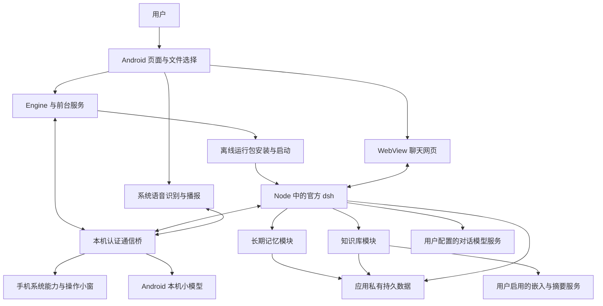

# 术语、整体架构与目录

[说明索引](README.md) · [术语与架构](architecture.md) · [返回项目](../README.md)

本文描述当前源码中的对象、进程与数据关系。先了解术语，再按目录定位对应模块；历史设计和已实现能力分别判断。

## 术语与整体架构

下列概念贯穿后文；表中的“创建方”说明对象由谁创建，或相关配置由谁提供。

| 名称 | 它是什么、创建方与职责 | 与相近概念的区别 |
|---|---|---|
| Android 宿主 | `app/` 中的 Kotlin 应用，由 Android 系统创建；提供页面、前台服务、文件选择、权限入口和本机进程管理 | 宿主启动 dsh，但本身不重新实现完整聊天引擎 |
| Node.js（Node） | 随运行包分发、由宿主启动的 JavaScript 执行程序；运行 dsh 与 `core/*.mjs` | Node 是运行程序的环境，dsh 是在其中执行的业务引擎 |
| 运行包（core） | `tools/core.py` 构建、随 APK 分发的离线文件集合，包含 Node、dsh、网页、命令和适配模块；APK 是 Android 安装包 | 运行包可以替换；用户会话、资料、凭据不应存放在其中 |
| 智能体（Agent） | dsh 在处理会话时创建的执行对象，负责逐步请求模型并执行工具 | 它有当前执行状态；会话保存可在重启后恢复的历史，两者不等同 |
| 会话（Session） | dsh 创建并分配唯一编号的一段对话，保存消息、请求配置和工具事件 | 会话标题可改，编号不变；会话历史也不等于独立长期记忆 |
| 工具（Tool） | 引擎向模型声明的命名操作，模型提交名称和结构化参数后，由已注册实现执行 | 模型提出调用不代表已执行成功；网页上用户直接操作的终端、插件管理也有各自入口 |
| 原生通信桥 | 每次启动由 `Engine` 创建的 `PolicyBridge` 服务端，以及 Node 中的 `host.mjs` 客户端；用本机认证连接交换会话、手机、本地模型和管理请求 | 它是按行传 JSON 的 TCP 长连接，TCP 是进程间传输字节的连接协议；与浏览器加载聊天网页的 HTTP 服务分开 |
| 启动实例（instance） | `Engine` 每次启动时生成的随机编号，绑定本次通信、会话登记和取消状态 | 重新启动会变更实例编号，持久保存的会话编号仍可保持不变 |
| Full（完全权限） | 宿主为本次有效登记的会话统一返回的工具准入模式，允许使用应用已有系统访问权限 | 不授予手机 root，也不替代系统权限或手机能力开关；工作区只是默认目录 |
| 工作区（workspace） | 应用创建的默认任务目录，也用于区分当前项目的记忆和资料可见范围 | Full 下工作区不是文件隔离边界；知识工具仍按真实会话范围过滤来源 |
| 长期记忆 | 由用户管理、或由受控后台整理任务生成的偏好、事实和经验；存储模块保存独立条目 | 不把全部会话原文当作记忆，也不包含用户导入的全部参考文档 |
| 知识库 | 用户主动导入的 Markdown、TXT 等参考资料，以及用于检索的分块、索引和概览 | 文档正文与记忆条目分开存储；统一搜索只组合可见结果，不合并两种正式数据 |
| 数据领域（storage domain） | dsh 的 `dsh-storage-domain` 提供的持久化接口；记忆和知识模块分别声明自己的数据结构，再由 JSON 后端写盘 | 它约束业务状态与写入方式；不表示另外运行一个数据库服务器 |
| 修订号（revision） | 存储模块在内容或设置变更时递增的数字，管理端带上读到的旧值保存，用于发现并发编辑 | 正文版本表示某份文档的内容版本；任务状态代次 `epoch` 用于使旧整理任务失效，三者用途不同 |
| 嵌入（embedding）与向量 | 用户指定的嵌入模型把文字转成一组数字，知识模块用这些数字比较语义相似程度 | 嵌入模型不生成聊天回答；对话服务可用不代表同一服务支持嵌入接口 |
| token 与上下文 | token 是模型计量文本的单位，上下文是单次模型能接收的输入与输出容量；容量来自实际模型信息 | token 不等于字符或 UTF-8 字节；部分模块用字节作保守上界，账本只记录实际报告的用量 |

整体关系如下。两个方向的箭头表示请求与结果交接，不表示数据自动同步到外部服务。

图中的 **WebView** 是 Android 系统提供、由 `MainActivity` 创建的网页容器，用于显示随 dsh 打包的聊天页面；它的网页渲染进程与 Node 引擎进程分别运行。**前台服务**是 Android 为持续任务提供、带常驻通知的服务组件，由用户操作触发系统创建，用于管理引擎或麦克风生命周期，不等于应用页面一直可见。

## 目录与模块总览

| 目录或入口 | 作用 | 是否进入正式应用 |
|---|---|---|
| [`app/`](../app) | Kotlin Android 宿主，包含管理页面、服务、手机桥、语音、文件交接与会话备份 | 是，正式模块 |
| [`app/src/main/cpp/`](../app/src/main/cpp) | 本机小模型的 C++ 调用层及 CMake 编译配置 | 是，编译成原生库 |
| [`app/src/main/assets/`](../app/src/main/assets) | 网页主题、模型清单、语音小文件与许可，以及构建生成的三个运行包资源 | 是；大型按需模型另行下载 |
| [`core/`](../core) | Node 侧 Android 适配、手机工具、语音接入、记忆、知识、依赖锁定与原生兼容代码 | 指定运行文件由构建工具收集，非整个目录原样打包 |
| [`tools/core.py`](../tools/core.py) | 准备官方 dsh 与 Android 命令，应用固定补丁、编译兼容层并生成运行包 | 开发机工具，手机不执行该 Python 脚本 |
| [`tools/voice.py`](../tools/voice.py) | 准备固定语音运行库、唤醒资源、模型清单和 llama.cpp 源码 | 开发机工具 |
| [`app/src/test/`](../app/src/test) · [`core/test.mjs`](../core/test.mjs) | 当前宿主与适配模块的定向回归测试 | 不作为正式功能打包 |
| [`prototype/`](../prototype) | 早期独立原型，演练文件整理、任务确认、停止和恢复交互 | 独立安装，不是正式聊天引擎 |
| 本地 `p0/` · [`tools/p0.py`](../tools/p0.py) | 早期任务样本、调研模板、环境采集及证据记录；`p0/` 由 Git 忽略，脚本保留在仓库 | 不进入正式运行链路 |
| [`docs/`](.) | 当前使用、模块职责、原理、数据与构建说明 | 可纳入版本管理的开发文档 |
| `plan/` | 原有计划、调研、阶段记录与旧说明，迁移时原样保留 | 仅本地保存，不参与构建和提交 |
| [`settings.gradle.kts`](../settings.gradle.kts) · [`build.gradle.kts`](../build.gradle.kts) · [`gradle/`](../gradle) | 注册 `app` 和 `prototype` 两个模块，固定构建插件与 Gradle Wrapper | 开发机构建基础 |
| `build/outputs/` · `core/cache/` · `core/node_modules/` | 本机产物、证据、下载缓存和依赖安装目录 | 不作为源码提交；其中选定内容会被构建工具装入运行包 |
